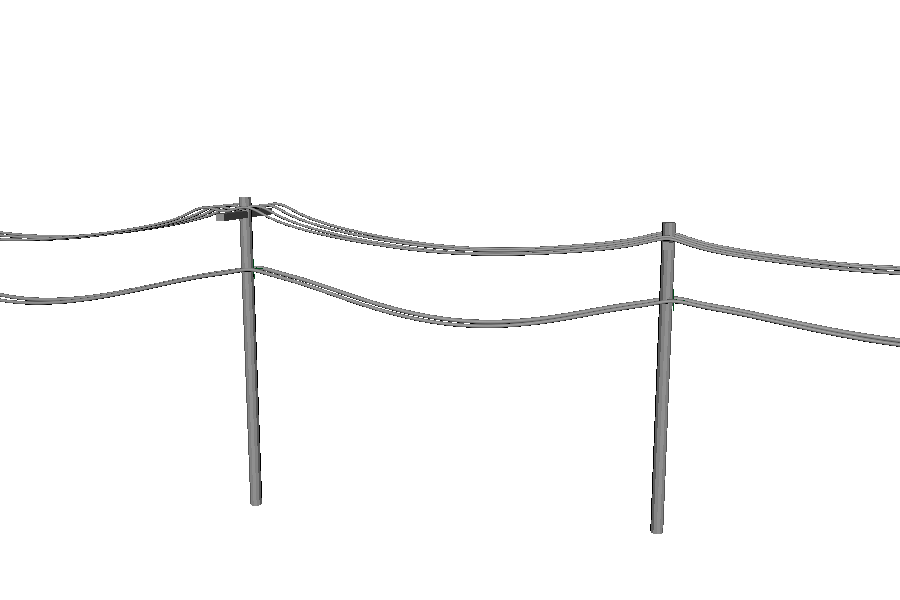
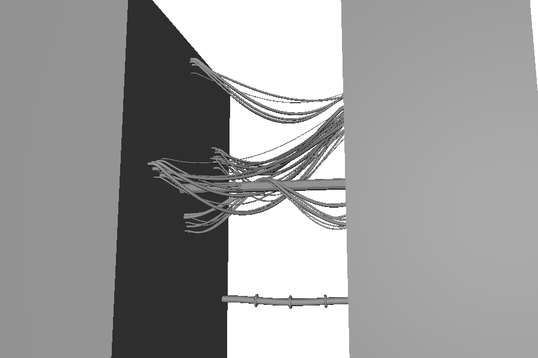
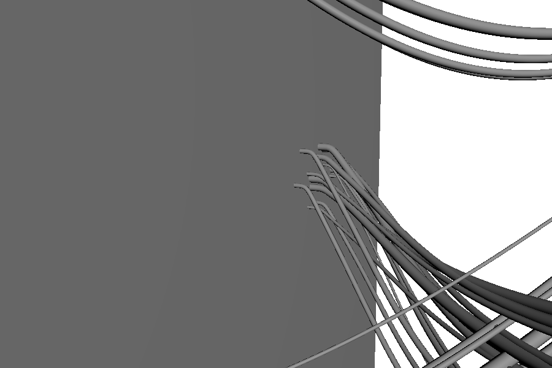
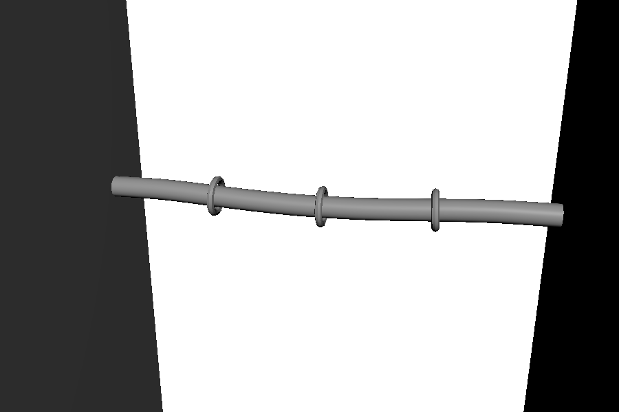
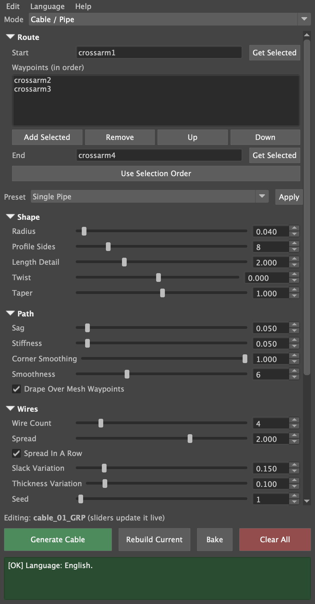
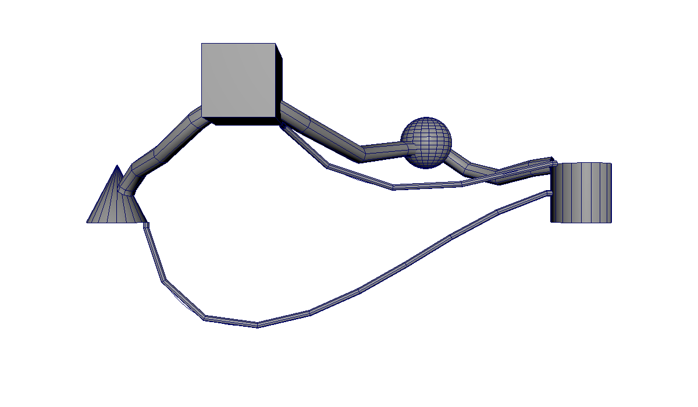
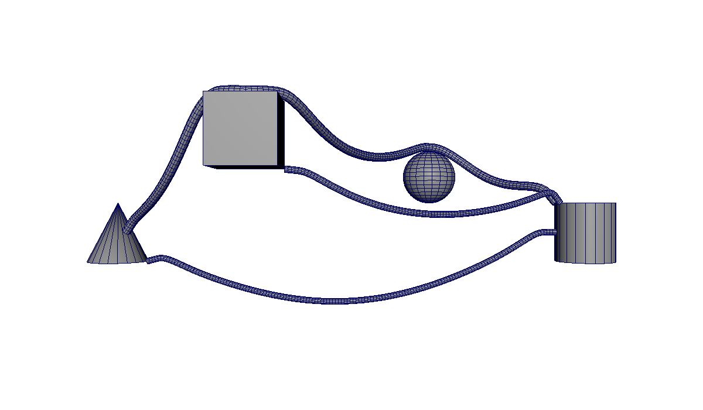
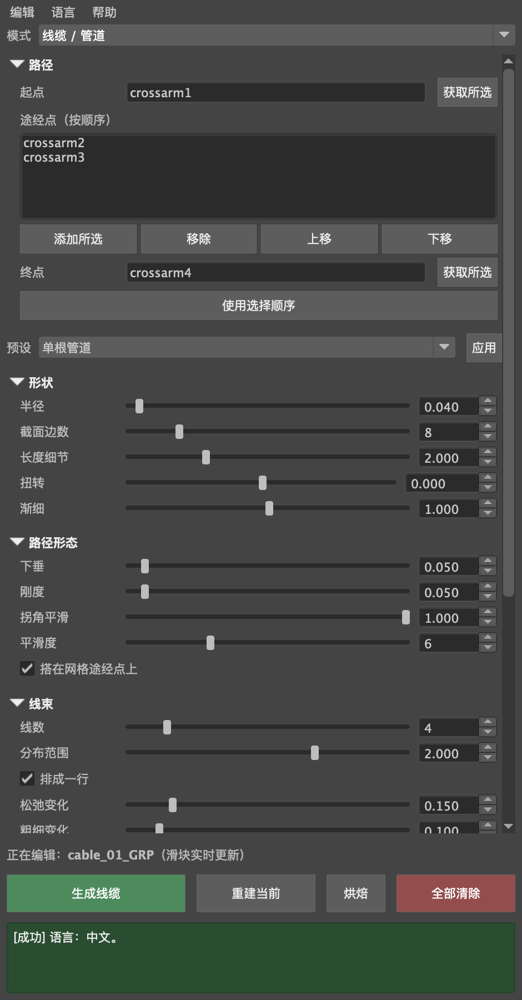

# Maya Procedural Route Tool

**Author:** Jianrui(Jerry) Xu

A Maya Python/Qt plugin that builds **live, physically hanging cables, pipes and wire bundles** along a route of picked objects, locators, vertices or faces. Move anything the cable is attached to and it re-settles: it sags under gravity, drapes over supports, plugs into surfaces along their normals and never passes through the objects it touches.

Built for SVA *Programming for Animators* (midterm). **Cable / Pipe** mode is complete; **Fence** and **Road** modes are planned and already listed in the Mode dropdown.

| Utility poles | Cyberpunk alley |
|---|---|
|  |  |
| **Wires plugged into wall faces** | **Clamps riding a pipe** |
|  |  |

**Contents:** [Features](#features) · [Install](#install) · [Quick start](#quick-start) · [Using the tool](#using-the-tool) · [How it works](#how-it-works) · [Project layout](#project-layout) · [Testing](#testing) · [Known limits](#known-limits) · [Roadmap](#roadmap) · [Course record](#course-record)

---

## Features
- **Real hanging shape.** A custom solver node simulates each cable as a rope: fixed length, gravity, bending stiffness and collision with the objects it is attached to. Sag follows horizontal span, so a vertical run hangs straight and the low point of an uneven span moves toward the lower end.
- **Live.** Everything is a Maya node network driven by the anchors' matrices and meshes, so moving, rotating or editing an anchor updates the cable, with no scripts running per frame and no constraints to break.
- **Any anchor.** Objects, locators, groups and joints, or a single **vertex or face**, which acts as a port: the cable plugs in there and leaves along the surface normal, even on a deforming mesh.
- **Routing.** Start, any number of waypoints and End. Mesh waypoints are **draped over** like a cable resting on a support; locators are passed through.
- **Wire runs.** One route can carry many wires, side by side like power lines or tangled at random, each with its own slack and thickness (repeatable with a seed).
- **Presets:** Single Pipe, Utility Line, Cyberpunk Tangle.
- **Production details:** Sweep Mesh tube with live radius, sides, twist and taper; end caps; UVs that tile along the length at a set rate; clamps or any custom mesh instanced along each wire; **Bake** to plain meshes.
- **Five languages:** English, 简体中文, 粵語, Español, Français.
- **Safe to use:** every action is one undo step, errors explain how to fix the problem, and cleanup only ever touches nodes the tool made.

## Install
Developed and tested in **Maya 2026** on macOS. Earlier versions are untested: Sweep Mesh needs Maya 2022 or later, and the tool also uses newer math nodes such as `multDL`.

1. Download or clone this repository and keep the `CableTool` folder somewhere permanent.
2. Drag `CableTool/install.py` into Maya's viewport. It registers the module, loads the plugin, sets it to auto-load and adds a **Cable Tool** shelf button.

Without installing, you can also load `CableTool/plug-ins/cableTool.py` from **Windows › Settings/Preferences › Plug-in Manager › Browse**.

## Quick start
1. Open the tool from the **Cable Tool** menu in Maya's menu bar, the shelf button, or `cmds.cableTool()`.
2. Select two or more anchors in the order the cable should run (objects, locators, vertices or faces) and press **Use Selection Order**.
3. Optionally pick a **Preset** and press **Apply**, then press **Generate Cable**.
4. Move any anchor: the cable follows. The sliders edit the cable live, and every setting is also on the cable's group in the Channel Box.

**Demo scene:** run `exec(open("/path/to/tests/demo_scene.py").read())` in the Script Editor for the utility poles and the cyberpunk alley shown above. Call `demo("peer")` afterwards for the peer-review scene (cone, cube, sphere, cylinder).

## Using the tool


| Area | Controls |
|---|---|
| **Menu bar** | Edit (Reset Settings, Load Selected, Delete Selected, Clear All) · **Language** · Help |
| **Mode** | `Cable / Pipe`; `Fence` and `Road` are listed greyed out until built |
| **Route** | `Start`, ordered `Waypoints`, `End`, each with `Get Selected`; **Use Selection Order** fills all three from the selection |
| **Preset** | Single Pipe · Utility Line · Cyberpunk Tangle + `Apply` |
| **Shape** | Radius · Profile Sides · Length Detail · Twist (degrees) · Taper |
| **Path** | Sag · Stiffness · Corner Smoothing · Smoothness · Drape Over Mesh Waypoints |
| **Wires** | Wire Count · Spread · Spread In A Row · Slack Variation · Thickness Variation · Seed |
| **Ends** | Attach Ends to Surface · Lead-out Length |
| **Surface** | End Caps · Texture Repeat per Unit |
| **Hardware** | Clamp Mesh (empty = a plain ring) · Clamp Count · Clamp Size |
| **Footer** | Generate · Rebuild Current · Bake · Clear All · colour-coded status box |

- **Anchors.** A whole mesh as Start/End attaches to the surface point facing the next anchor. A **vertex or face** is a port: the cable leaves exactly along its normal. Several wires at a port fan out across the surface, so a bundle plugged into a wall spreads over the wall.
- **Live vs rebuild.** Every setting updates instantly except **Wire Count** and **Clamp Count**, which change how many nodes there are. Those rebuild the cable in place when you release the slider.
- **Load Selected** reads a cable's settings, route and clamp mesh back into the window, so you can keep editing it later or in another session.
- **Bake** turns the current cable into plain meshes (wires and clamps) with no history, in `<name>_baked_GRP`. Ctrl+Z brings the live cable back.
- **Clamp Mesh:** model your clamp at the origin around a tube of radius 1 lying along +X; it is instanced, never copied or deleted.
- **Language:** switch from the window's **Language** menu. The window rebuilds in place and keeps everything on it. Until you choose, the tool follows Maya's interface language.

<br clear="right">

## How it works
### Node network (per wire)
```
anchor.worldMatrix ─┐
anchor mesh.outMesh ┼─▶ cableToolSolver ─▶ nurbsCurve ─▶ sweepMeshCreator ─▶ polyMoveUV ─▶ mesh
cable group settings┘          │                │
                               └─▶ outRadius     └─▶ pointOnCurveInfo ─▶ clamp instances
```
The cable's group holds every setting as a keyable attribute wired into each wire's solver and Sweep Mesh. A run with several wires has one such network per wire.

### The solver (`cableToolSolver`)
A Python API 2.0 `MPxNode` registered by the plugin. Every time an input changes it works in two stages:

1. **Rest shape (analytic).**
   - **Path points:** mesh ends sit on the surface facing the next anchor; ports use the vertex or face and its normal; draped waypoints sit on top of the object, lifted by the tube radius.
   - **Between points:** a Catmull-Rom spline (blended with straight lines by *Corner Smoothing*) sagging by a catenary weight × *Sag* × the span's horizontal length.
2. **Relaxation (rope physics).**
   - **The chain:** the rest shape becomes a particle chain, about one point per tube diameter, with fixed segment lengths.
   - **Each Verlet step:** applies gravity, then several passes of length constraints, a bending constraint (*Stiffness*) and collision with every mesh the cable is attached to. Path points and a straight *Lead-out Length* off each mesh end are pinned.
   - **Speed:** the previous result warm-starts the next solve, so dragging is fast.

Tuned on a test cable to keep length within about 1% and bends no tighter than a few tube radii. Measured in Maya 2026 on the peer-review scene: no cable passes through any object, lengths stay within ~1.5%, and the tightest bends are 1.7–4.8 tube radii.

### Other parts
- **Tube:** Sweep Mesh in *Distance* interpolation, a ring every tube diameter ÷ *Length Detail*, so it is smooth at any scene scale. Twist is shown in degrees and converted to the whole turns Sweep Mesh uses.
- **UVs:** Sweep Mesh's *Unfold* UVs (V along the cable, U around it, square texels) scaled by the live arc length (`curveInfo`) × *Texture Repeat per Unit*, so a striped texture tiles at the same density on every cable.
- **Wire runs:** each wire draws from its own random stream (Seed + wire index). In a row, wires stay parallel across *Spread*; in a cluster, each lands at a random spot at every anchor, so they cross.
- **Clamps:** `pointOnCurveInfo` gives each clamp its position and tangent, two cross products and a `fourByFourMatrix` turn that into a frame along the cable, and the scale follows the wire's radius × *Clamp Size*.
- **Modes:** `generators.GENERATORS` lists every mode. The dropdown, the settings panels and the Generate button are built from it. A mode declares its settings and builds its own network; the shared base handles the group, stored settings, Load, Rebuild, Bake and Delete.
- **Scene safety:**
  - **Undo:** one undo chunk per action, and a whole slider drag is a single Ctrl+Z.
  - **Errors:** limits the tool enforces become warnings that say how to fix them, and a catch-all keeps unexpected errors out of Maya.
  - **Input:** every value is sanitised (empty, text, NaN, infinity).
  - **Cleanup:** every created node is tagged, so Clear All and Delete never touch the artist's own nodes, even ones with similar names.
- **Languages:** every artist-facing string goes through `tr()` with the English text as its key. `locales/<code>.json` holds each translation, and anything missing falls back to English. Messages are whole sentences with `{0}` placeholders, so each language can order its words naturally.
  - **Chinese** uses the names from Maya's own Chinese interface.
  - **Cantonese** is written colloquial Cantonese in Traditional characters.
  - **Spanish and French** keep Maya's panel names in English, because Maya has no interface in those languages.

## Project layout
```
CableTool/                       the Maya module (point Maya here)
├── CableTool.mod
├── install.py                   drag-and-drop installer
├── icons/cableTool.png          menu / shelf icon
├── plug-ins/cableTool.py        plugin entry point: command, solver node, menu
└── scripts/cable_tool/          the tool, as a Python package
    ├── config.py                settings table (defaults, ranges, tips), sanitising
    ├── solver.py                cableToolSolver: rest shape + rope physics
    ├── route.py                 anchors: objects, locators, vertices, faces
    ├── nodes.py                 tagging, cleanup, undo, Sweep Mesh plugin
    ├── ui.py                    the Qt window
    ├── menu.py                  the Cable Tool menu in Maya's menu bar
    ├── i18n.py, locales/        languages
    ├── dev.py                   reload helper, list of interface strings
    └── generators/              one generator per mode (registry, base, cable, planned)
docs/images/                     screenshots for this README
tests/
├── test_cable_rig.py            40 headless rig, physics and language tests
├── test_ui.py                   headless window test
└── demo_scene.py                utility poles, cyberpunk alley, peer-review scene
```

## Testing
The tests run headlessly with Maya's Python (replace `maya2026` with your version):
```
MAYAPY=/Applications/Autodesk/maya2026/Maya.app/Contents/bin/mayapy
$MAYAPY tests/test_cable_rig.py
QT_QPA_PLATFORM=offscreen $MAYAPY tests/test_ui.py
```
They cover:
- **Physics:** length kept, sag scaling, vertical runs, the low point, draping without cutting through objects, bend limits.
- **Anchors:** ports on vertices and faces, following moves and mesh edits.
- **Wires and hardware:** multi-wire spread and seeds, clamps, UVs, end caps, Bake.
- **Scene safety:** undo, cleanup and the installer.
- **Languages:** every string translated in every language, with its placeholders.
- **Window:** a full session in each of the five languages.

## Known limits
- **Speed with many wires:** dragging a crossarm that carries dozens of wires re-solves all of them, at about 0.16 s per update in the demo.
- **Sharp edges:** where a cable bends over a sharp edge, the tube can graze it by up to about a fifth of its radius. It never cuts through.
- **Unloading:** Maya won't unload the plugin while any cable exists (even in the undo queue). Start a new scene first.
- **Platforms:** tested in Maya 2026 on macOS only.

## Roadmap
Cables, fences and roads are all curve-driven geometry, so the mode architecture lets one tool build all three:

| Building block | Cable / Pipe | Fence | Road |
|---|---|---|---|
| Route, waypoints, live curve | ✅ | planned | planned |
| Sweep Mesh profile | round tube | thin box rails | flat, wide surface |
| Hardware along the length | clamps | **fence posts** | lamp posts, markers |
| Length-wise UVs | ribbed / striped | wood grain | **lane markings** |
| **Hard part** | contact and attachment | vertical posts on uneven ground, gates | terrain conforming, banking, intersections |

Next: basic Fence, then basic Road; after that terrain conforming, gates and road intersections.

---

## Course record
The midterm's pitch, plan and peer feedback, kept as submitted.

<details>
<summary><b>Pitch</b></summary>

**1. The tool in one sentence.** A Maya Python/Qt plugin that procedurally generates customizable pipes and cables that route through picked objects, locators or mesh components, plug into surfaces along their normals, and stay live as anything they're attached to moves.

**2. The chore it ends.** Drawing CV curves, extruding profiles, rigging endpoints, adjusting sag, placing clamps and fixing UVs by hand takes 15–20 minutes per cable. This tool does it in a few clicks.

**3. The UI.** One window with a pinned footer, collapsible sections, tooltips on every control, sliders with a typed field and a hard safety cap, and a colour-coded status box whose messages say how to fix a problem. See [Using the tool](#using-the-tool).

**4. Why it's advanced.** Sweep Mesh core with editable history; live following with no clusters or constraints to break; waypoint routing; component attachment along normals; hardware instanced along the length; length-wise UVs. Since the pitch it has also gained a custom physics solver node, multi-wire runs and five interface languages.

**6. MVP.** A plugin that loads from Maya's Plug-in Manager and opens a Qt UI where selecting two objects generates a Sweep Mesh cable whose ends follow those objects live, with working Radius and Sag sliders.

**7. The riskiest part.** Getting the cable to leave a picked vertex or face cleanly along its normal and stay attached while the mesh deforms, and keeping sag live alongside waypoints without the curve kinking.
</details>

<details>
<summary><b>The three weeks: plan and status</b></summary>

**By Oct 13: plugin shell + Sweep foundation** ✅
- Module folder, `cableTool.py` plugin with the `cableTool` command and **Cable Tool** menu.
- Qt UI opened from that menu; Sweep Mesh along a curve between two objects; radius, profile, twist and taper sliders.

**By Oct 20: live rig (core goal)** ✅
- Ends follow their objects live; sag stays live; waypoints.

**By Oct 26: components, hardware, UVs, polish** ✅
- Component attachment along normals, staying attached when the mesh moves or deforms.
- Hardware instanced along the cable, following it live; end caps.
- Length-wise UVs.
- Presets, bake, undo, edge-case error handling, UI polish.
- Packaging: `.mod` file, drag-and-drop installer, shelf icon, clean unload.

**Stretch**
1. ✅ Multi-wire bundles and variation.
2. Basic Fence mode: posts plus swept rails, on flat ground.
3. Basic Road mode: flat swept ribbon with lane-marking UVs.
</details>

<details>
<summary><b>Lessons from my previous tool</b></summary>

In September I built `CableHoseRigTool.py`, a one-shot generator: it computed every point in Python and built meshes with no history, so any change meant clearing and regenerating. This midterm turns that idea into a **live, node-based** tool.

| Keep | Drop | Fix |
|---|---|---|
| Pinned footer, collapsible sections, colour-coded status box | Hand-built coordinate frames (Sweep Mesh orients the tube) | Selection order not guaranteed → `orderedSelection` |
| Actionable messages, tooltips, safety-capped fields | Extrude / cylinder fallback with history off | Generating twice left empty groups; cleanup by name prefix → tag-based cleanup |
| Undo chunks, two-level error handling, input sanitising | | Defaults written twice → one `DEFAULTS` table |
| Sag scaled by span length; catenary shape | | Clear was all-or-nothing → per-cable Load / Delete |
| Multi-pick spans → grown into waypoint routing | | |
</details>

<details>
<summary><b>Peer run: Tong Lin, and what changed</b></summary>

1. **What I did:** I loaded the plug-in in Maya 2026, picked a cone, a cube, a sphere and a cylinder in order as start, waypoints and end, generated a few cables, and then changed the Twist and Smoothness settings and added more waypoints.
2. **What happened:** The cables were generated and followed the objects, but after changing Twist the tube became kinked and twisted into separate segments instead of a smooth cable, and where the cable meets the start and end objects the tube narrows to a sharp point and the cables cross each other.
3. **What confused me or broke:** Smoothness didn't update live like the other settings (I had to press Rebuild to see it), and when I added several waypoints the cable bent into sharp, tight corners around them instead of a smooth turn.

| Problem | Cause | Fix |
|---|---|---|
| Twist kinked the tube into segments | Sweep Mesh counts Twist in whole turns; the tool passed degrees, so 90 became 90 turns | Degrees are converted to turns |
| The tube narrowed to a point at the end objects, and cables crossed | Every cable ended at the object's pivot, inside it | Ends sit on the surface facing the next anchor and leave outward |
| Smoothness didn't update live | It changed the curve's point count, which needed a Rebuild | The solver re-samples live |
| Sharp corners at waypoints | Straight lines between waypoints, and sag meeting in a V | A smooth spline through waypoints, then rope physics |

A later live re-test in Maya found three more problems:
- **Faceted tubes:** Sweep Mesh's default put cross-section rings only at a few points.
- **Kinks at the surfaces:** cables kinked or folded where they left a surface.
- **Cutting through objects:** cables routed through a mesh waypoint ran through its middle, then cut through its walls.

Those led to the physics solver.

| Before (peer-run scene) | After |
|---|---|
|  |  |
</details>

<details>
<summary><b>The window in Chinese</b></summary>


</details>
