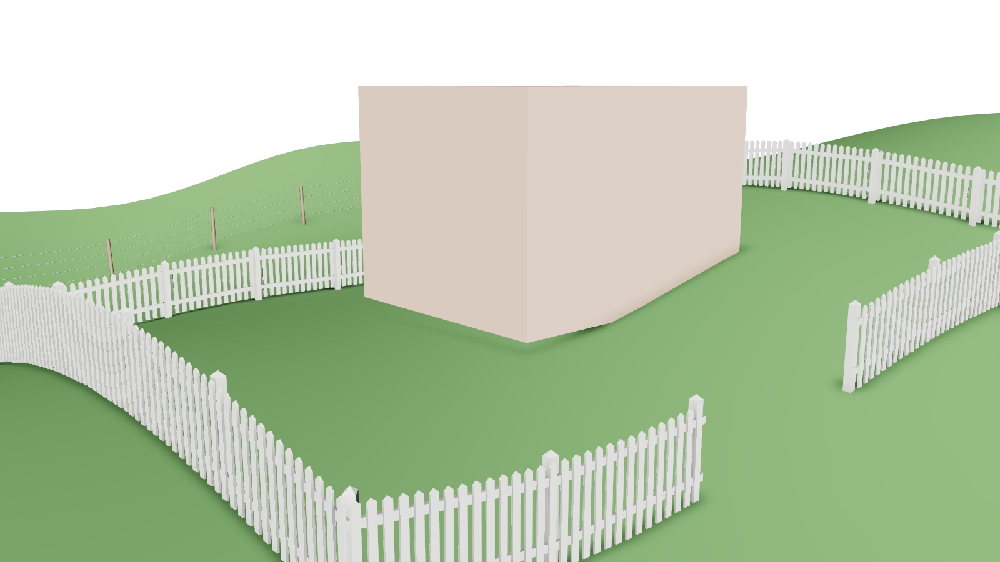

# Maya Procedural Route Tool

**Author:** Jianrui(Jerry) Xu

A Maya Python/Qt plugin that builds live geometry along a route of picked objects, locators, vertices or faces. Pick the route once, choose what to build, and move anything on the route afterwards: the build follows.

| Mode | Status | What it builds |
|---|---|---|
| **Cable / Pipe** | ✅ complete | Physically hanging cables, pipes and wire bundles that sag, drape over supports, plug into surfaces along their normals and never pass through the objects they touch |
| **Fence** | ✅ complete | Posts, rails and pickets that step over uneven ground, turn corners with mitred rails and close into yards |
| **Road** | planned | A flat ribbon with lane-marking UVs (listed greyed out in the Mode dropdown) |

Built for SVA *Programming for Animators* (midterm).

| Utility poles | Cyberpunk alley |
|---|---|
|  |  |
| **Picket-fenced yard on rolling ground** | **Ranch rail curving over a hill** |
|  |  |

**Contents:** [Features](#features) · [Install](#install) · [Quick start](#quick-start) · [Using the tool](#using-the-tool) · [How it works](#how-it-works) · [Project layout](#project-layout) · [Testing](#testing) · [Known limits](#known-limits) · [Roadmap](#roadmap) · [Course record](#course-record)

---

## Features
### Cable / Pipe
- **Real hanging shape.** A custom solver node simulates each cable as a rope: fixed length, gravity, bending stiffness and collision with the objects it is attached to. Sag follows horizontal span, so a vertical run hangs straight and the low point of an uneven span moves toward the lower end.
- **Ports.** A single **vertex or face** is a port: the cable plugs in there and leaves along the surface normal, even on a deforming mesh. Mesh waypoints are **draped over** like a cable resting on a support.
- **Wire runs.** One route can carry many wires, side by side like power lines or tangled at random, each with its own slack and thickness (repeatable with a seed).
- **Production details:** Sweep Mesh tube with live radius, sides, twist and taper; end caps; UVs that tile along the length at a set rate; clamps or any custom mesh instanced along each wire.
- **Presets:** Single Pipe, Utility Line, Cyberpunk Tangle.

### Fence
- **Posts where a builder would put them.** At most *Post Spacing* apart, evenly, with a post on every anchor so corners are square. A route that ends where it started closes into a ring, for yards and paddocks.
- **Stands on the ground.** Pick a **Ground** mesh and every post and picket is dropped onto it, so the fence steps over hills and the pickets follow the slope one by one. Move or reshape the ground and the fence follows.
- **Built like a real fence.** Rails are straight lumber from post to post, fixed to the posts' front face (or through them) and **mitred** where the fence turns, so corners close without gaps or overlaps. Pickets are nailed to the front of the rails.
- **Many kinds of fence from one tool:** square or round posts with flat or pointed caps; board rails, or round rails that act as **sagging wires** or **pipe railings**; pickets with any width, gap and point; a curved or straight path.
- **Your own parts.** Use any mesh as the post or the picket; it keeps its UVs and its hard and soft edges.
- **Wear.** Posts and pickets lean and vary in height for an old fence, repeatable with a seed.
- **Ready to texture:** posts, rails and pickets are separate meshes (one material each), with UVs in scene units and the grain along every board.
- **Presets:** Picket Fence, Ranch Rail, Privacy Fence, Wire Fence, Pipe Railing.

### Both modes
- **Live.** Everything is a Maya node network driven by the anchors' matrices, with no scripts running per frame and no constraints to break. Every setting is also on the build's group in the Channel Box.
- **Any anchor:** objects, locators, groups and joints, vertices and faces; anchors inside moving groups follow too.
- **Load, Rebuild, Bake** (to plain meshes with no history) and Delete for each build.
- **Five languages:** English, 简体中文, 粵語, Español, Français.
- **Safe to use:** every action is one undo step, errors explain how to fix the problem, and cleanup only ever touches nodes the tool made.

## Install
Developed and tested in **Maya 2026** on macOS. Earlier versions are untested: Sweep Mesh needs Maya 2022 or later, and the tool also uses newer math nodes such as `multDL`.

1. Download or clone this repository and keep the `CableTool` folder somewhere permanent.
2. Drag `CableTool/install.py` into Maya's viewport. It registers the module, loads the plugin, sets it to auto-load and adds a **Cable Tool** shelf button.

Without installing, you can also load `CableTool/plug-ins/cableTool.py` from **Windows › Settings/Preferences › Plug-in Manager › Browse**.

## Quick start
1. Open the tool from the **Cable Tool** menu in Maya's menu bar, the shelf button, or `cmds.cableTool()`.
2. Choose a **Mode**: Cable / Pipe or Fence.
3. Select two or more anchors in the order the build should run (objects, locators, vertices or faces) and press **Use Selection Order**.
4. For a fence on terrain, select the ground and press **Get Selected** next to **Ground**.
5. Optionally pick a **Preset** and press **Apply**, then press **Generate**.
6. Move any anchor: the build follows. The sliders edit it live.

**Demo scenes:** in the Script Editor, run `exec(open("/path/to/tests/demo_scene.py").read())`. It builds the utility poles and cyberpunk alley shown above. Then call:
- `demo("fence")` for the farm: a picket-fenced yard with a gate, a ranch fence over a hill, a wire fence, a privacy fence and a pipe railing on a wall.
- `demo("peer")` for the peer-review scene (cone, cube, sphere, cylinder).

## Using the tool
### Shared controls
| Area | Controls |
|---|---|
| **Menu bar** | Edit (Reset Settings, Load Selected, Delete Selected, Clear All) · **Language** · Help |
| **Mode** | `Cable / Pipe` · `Fence` · `Road` (greyed out until built) |
| **Route** | `Start`, ordered `Waypoints`, `End`, each with `Get Selected`; **Use Selection Order** fills all three from the selection |
| **Preset** | the mode's presets + `Apply` |
| **Footer** | Generate · Rebuild Current · Bake · Clear All · colour-coded status box |

- **Load Selected** reads a build's mode, settings, route and picked meshes back into the window, so you can keep editing it later or in another session.
- **Bake** turns the current build into plain meshes with no history, in `<name>_baked_GRP`. Ctrl+Z brings the live build back.
- **Language:** switch from the window's **Language** menu. The window rebuilds in place and keeps everything on it. Until you choose, the tool follows Maya's interface language.

### Cable / Pipe


| Section | Controls |
|---|---|
| **Shape** | Radius · Profile Sides · Length Detail · Twist (degrees) · Taper |
| **Path** | Sag · Stiffness · Corner Smoothing · Smoothness · Drape Over Mesh Waypoints |
| **Wires** | Wire Count · Spread · Spread In A Row · Slack Variation · Thickness Variation · Seed |
| **Ends** | Attach Ends to Surface · Lead-out Length |
| **Surface** | End Caps · Texture Repeat per Unit |
| **Hardware** | Clamp Mesh (empty = a plain ring) · Clamp Count · Clamp Size |

- **Anchors.** A whole mesh as Start/End attaches to the surface point facing the next anchor. A **vertex or face** is a port: the cable leaves exactly along its normal. Several wires at a port fan out across the surface, so a bundle plugged into a wall spreads over the wall.
- **Live vs rebuild.** Every setting updates instantly except **Wire Count** and **Clamp Count**, which change how many nodes there are. Those rebuild the cable in place when you release the slider.
- **Clamp Mesh:** model your clamp at the origin around a tube of radius 1 lying along +X; it is instanced, never copied or deleted.

<br clear="right">

### Fence


| Section | Controls |
|---|---|
| **Layout** | Ground (a mesh, optional) · Post Spacing · Post At Every Anchor · Path Curve · Rails On Other Side |
| **Posts** | Post Mesh (optional) · Post Height · Post Width · Round Posts · Post Cap |
| **Rails** | Rail Count · Lowest Rail · Highest Rail · Rail Size · Rail Thickness · Round Rails · Rails Through Posts · Rail Sag |
| **Pickets** | Picket Mesh (optional) · Pickets · Picket Height · Picket Width · Picket Gap · Picket Thickness · Picket Point |
| **Surface** | Wear · Seed · Texture Repeat per Unit |

- **Everything is live,** including the number of posts and pickets: drag an anchor and posts are added or removed as the fence grows.
- **Heights are above the ground**, so a 1.2 m post is 1.2 m tall on a slope too. Without a Ground mesh the fence runs at the anchors' height.
- **Gates and yards.** Leave a gap by starting and ending the route at the two gate posts. To close a ring, end the route on the anchor it started from.
- **Wire fence:** turn on *Round Rails*, make *Rail Size* small and add a little *Rail Sag*. **Pipe railing:** round posts and rails with *Rails Through Posts*.
- **Post Mesh / Picket Mesh:** model the part standing on the origin, its front toward +X (a post) or +Z (a picket). It is scaled to Post Height or Picket Height. Picking one applies on Generate or Rebuild.

<br clear="right">

| Wire fence over the hill | The whole farm demo |
|---|---|
|  |  |

## How it works
### Cable / Pipe network (per wire)
```
anchor.worldMatrix ─┐
anchor mesh.outMesh ┼─▶ cableToolSolver ─▶ nurbsCurve ─▶ sweepMeshCreator ─▶ polyMoveUV ─▶ mesh
cable group settings┘          │                │
                               └─▶ outRadius     └─▶ pointOnCurveInfo ─▶ clamp instances
```
The cable's group holds every setting as a keyable attribute wired into each wire's solver and Sweep Mesh. A run with several wires has one such network per wire.

#### The cable solver (`cableToolSolver`)
A Python API 2.0 `MPxNode` registered by the plugin. Every time an input changes it works in two stages:

1. **Rest shape (analytic).**
   - **Path points:** mesh ends sit on the surface facing the next anchor; ports use the vertex or face and its normal; draped waypoints sit on top of the object, lifted by the tube radius.
   - **Between points:** a Catmull-Rom spline (blended with straight lines by *Corner Smoothing*) sagging by a catenary weight × *Sag* × the span's horizontal length.
2. **Relaxation (rope physics).**
   - **The chain:** the rest shape becomes a particle chain, about one point per tube diameter, with fixed segment lengths.
   - **Each Verlet step:** applies gravity, then several passes of length constraints, a bending constraint (*Stiffness*) and collision with every mesh the cable is attached to. Path points and a straight *Lead-out Length* off each mesh end are pinned.
   - **Speed:** the previous result warm-starts the next solve, so dragging is fast.

Tuned on a test cable to keep length within about 1% and bends no tighter than a few tube radii. Measured in Maya 2026 on the peer-review scene: no cable passes through any object, lengths stay within ~1.5%, and the tightest bends are 1.7–4.8 tube radii.

#### Other cable parts
- **Tube:** Sweep Mesh in *Distance* interpolation, a ring every tube diameter ÷ *Length Detail*, so it is smooth at any scene scale. Twist is shown in degrees and converted to the whole turns Sweep Mesh uses.
- **UVs:** Sweep Mesh's *Unfold* UVs (V along the cable, U around it, square texels) scaled by the live arc length (`curveInfo`) × *Texture Repeat per Unit*, so a striped texture tiles at the same density on every cable.
- **Wire runs:** each wire draws from its own random stream (Seed + wire index). In a row, wires stay parallel across *Spread*; in a cluster, each lands at a random spot at every anchor, so they cross.
- **Clamps:** `pointOnCurveInfo` gives each clamp its position and tangent, two cross products and a `fourByFourMatrix` turn that into a frame along the cable, and the scale follows the wire's radius × *Clamp Size*.

### Fence network
```
anchor.worldMatrix (+ mesh for a vertex/face) ─┐
ground.outMesh + ground.worldMatrix ───────────┤                    ┌─▶ outPosts   ─▶ <name>_posts_geo
post / picket mesh.outMesh ────────────────────┼─▶ fenceToolBuilder ┼─▶ outRails   ─▶ <name>_rails_geo
fence group settings ──────────────────────────┘                    └─▶ outPickets ─▶ <name>_pickets_geo
```
#### The fence builder (`fenceToolBuilder`)
A second `MPxNode` that makes the meshes itself, rather than with Sweep Mesh, so the number of posts and pickets can change live while an anchor is dragged. Every time an input changes it:

1. **Lays out the path:** straight runs between anchors, blended toward a Catmull-Rom curve by *Path Curve*, sampled densely for arc length. A closed route also curves smoothly through its start.
2. **Places the posts:** each run between anchors is divided into equal gaps no longer than *Post Spacing* (or the whole route, with *Post At Every Anchor* off). With a Ground mesh, a ray straight down (and up) through each post finds the ground; posts go half a post width into it so slopes never show a gap. *Wear* tilts each post's axis and varies its height from its own random stream (Seed + post number), so adding a post at the end never reshuffles the others.
3. **Joins them with rails:** every rail runs from post to post at its height up the post's axis (so rails follow a leaning post), stepped out to the front face. At a post where the fence turns, both rails step out along the **mitre** (the bisector of the two spans' sides, scaled by 1 ÷ cos of half the turn, capped for very sharp turns), so their ends meet exactly. Board rails are boxes with mitred ends; round rails are tubes that sag on a parabola.
4. **Fills the spans with pickets:** evenly spread over each span at *Picket Width* + *Picket Gap*, each dropped onto the ground on its own and nailed in front of the rails. A picket is its outline (with a point if *Picket Point* > 0) extruded by *Picket Thickness*.

**Mesh details:**
- **Boards** get their own vertices per face, so their edges are hard. **Round parts** share vertices round their sides, so they shade smooth.
- **UVs** are each face's corners in scene units × *Texture Repeat per Unit*, with U along the board, so wood grain runs the length of every rail and picket.
- **Custom Post / Picket meshes** are copied in with their UVs and locked normals, so their hard and soft edges survive.
- **Speed:** face building uses plain Python maths on 3-vectors instead of numpy calls, which made the yard fence (1,300 parts) about 3× faster to drag.

### Shared parts
- **Modes:** `generators.GENERATORS` lists every mode. The dropdown, the settings panels, the pickers and the Generate button are built from it. A mode declares its settings, presets and picked meshes, and builds its own network; the shared base handles the group, stored settings, anchors, Load, Rebuild, Bake and Delete.
- **Scene safety:**
  - **Undo:** one undo chunk per action, and a whole slider drag is a single Ctrl+Z.
  - **Errors:** limits the tool enforces become warnings that say how to fix them, and a catch-all keeps unexpected errors out of Maya.
  - **Input:** every value is sanitised (empty, text, NaN, infinity).
  - **Cleanup:** every created node is tagged, so Clear All and Delete never touch the artist's own nodes, even ones with similar names.
- **Languages:** every artist-facing string goes through `tr()` with the English text as its key. `locales/<code>.json` holds each translation, and anything missing falls back to English. Messages are whole sentences with `{0}` placeholders, so each language can order its words naturally.
  - **Chinese** uses the names from Maya's own Chinese interface.
  - **Cantonese** is written colloquial Cantonese in Traditional characters.
  - **Spanish and French** keep Maya's panel names in English, because Maya has no interface in those languages.

## Project layout
```
CableTool/                       the Maya module (point Maya here)
├── CableTool.mod
├── install.py                   drag-and-drop installer
├── icons/cableTool.png          menu / shelf icon
├── plug-ins/cableTool.py        plugin entry point: command, both nodes, menu
└── scripts/cable_tool/          the tool, as a Python package
    ├── config.py                settings table (defaults, ranges, tips), sanitising
    ├── solver.py                cableToolSolver: rest shape + rope physics
    ├── fence.py                 fenceToolBuilder: fence layout and meshes
    ├── route.py                 anchors: objects, locators, vertices, faces
    ├── nodes.py                 tagging, cleanup, undo, Sweep Mesh plugin
    ├── ui.py                    the Qt window
    ├── menu.py                  the Cable Tool menu in Maya's menu bar
    ├── i18n.py, locales/        languages
    ├── dev.py                   reload helper, list of interface strings
    └── generators/              one generator per mode (registry, base, cable, fence, planned)
docs/images/                     screenshots for this README
tests/
├── test_cable_rig.py            51 headless rig, physics, fence and language tests
├── test_ui.py                   headless window test
└── demo_scene.py                utility poles, cyberpunk alley, farm, peer-review scene
```

## Testing
The tests run headlessly with Maya's Python (replace `maya2026` with your version):
```
MAYAPY=/Applications/Autodesk/maya2026/Maya.app/Contents/bin/mayapy
$MAYAPY tests/test_cable_rig.py
QT_QPA_PLATFORM=offscreen $MAYAPY tests/test_ui.py
```
They cover:
- **Cable physics:** length kept, sag scaling, vertical runs, the low point, draping without cutting through objects, bend limits.
- **Anchors:** ports on vertices and faces, following moves and mesh edits.
- **Wires and hardware:** multi-wire spread and seeds, clamps, UVs, end caps, Bake.
- **Fence:**
  - **Layout:** a post on every anchor, live post counts as an anchor moves.
  - **Geometry:** every part is closed with its faces pointing outward (signed volume), and rails meet exactly at corners.
  - **Ground:** posts stand on a sloped ground and follow it when it moves.
  - **Routes and parts:** closed rings without a doubled post, pickets on and off, custom post meshes, repeatable wear.
  - **Presets and undo:** every preset builds and loads back, and a build is one undo step.
- **Scene safety:** undo, cleanup and the installer.
- **Languages:** every string translated in every language, with its placeholders.
- **Window:** a full session in each of the five languages, including building and loading a fence.

## Known limits
- **Speed with many wires:** dragging a crossarm that carries dozens of wires re-solves all of them, at about 0.16 s per update in the demo. A picket fence with about 1,300 parts updates in about 0.05 s.
- **Sharp edges:** where a cable bends over a sharp edge, the tube can graze it by up to about a fifth of its radius. It never cuts through.
- **Fence corners:** pickets stop at each corner post, so a very tight corner shows a small gap between the two runs' pickets, as on a real fence. Square posts turn to face the bisector of a corner.
- **Fence ground:** each post and picket is dropped straight down (or up) onto the Ground mesh. Where the ground has no surface under a part, it stays at the route's height.
- **No gates yet:** a gate is a gap in the route.
- **Unloading:** Maya won't unload the plugin while any cable or fence exists (even in the undo queue). Start a new scene first.
- **Platforms:** tested in Maya 2026 on macOS only.

## Roadmap
Cables, fences and roads are all built along a route, so the mode architecture lets one tool build all three:

| Building block | Cable / Pipe | Fence | Road |
|---|---|---|---|
| Route, waypoints, live updates | ✅ | ✅ | planned |
| Main geometry | ✅ round tube (Sweep Mesh) | ✅ board or round rails | flat, wide surface |
| Parts along the length | ✅ clamps | ✅ posts and pickets | lamp posts, markers |
| Length-wise UVs | ✅ ribbed / striped | ✅ wood grain | **lane markings** |
| Hard part | ✅ contact and attachment | ✅ uneven ground, corners; gates next | terrain conforming, banking, intersections |

Next: gates for Fence (a hinged panel between two posts), then basic Road mode.

---

## Course record
The midterm's pitch, plan, progress and peer feedback.

<details>
<summary><b>Pitch</b></summary>

**1. The tool in one sentence.** A Maya Python/Qt plugin that procedurally generates customizable pipes and cables that route through picked objects, locators or mesh components, plug into surfaces along their normals, and stay live as anything they're attached to moves.

**2. The chore it ends.** Drawing CV curves, extruding profiles, rigging endpoints, adjusting sag, placing clamps and fixing UVs by hand takes 15–20 minutes per cable. This tool does it in a few clicks.

**3. The UI.** One window with a pinned footer, collapsible sections, tooltips on every control, sliders with a typed field and a hard safety cap, and a colour-coded status box whose messages say how to fix a problem. See [Using the tool](#using-the-tool).

**4. Why it's advanced.** Sweep Mesh core with editable history; live following with no clusters or constraints to break; waypoint routing; component attachment along normals; hardware instanced along the length; length-wise UVs. Since the pitch it has also gained a custom physics solver node, multi-wire runs, five interface languages and a complete Fence mode with its own builder node.

**6. MVP.** A plugin that loads from Maya's Plug-in Manager and opens a Qt UI where selecting two objects generates a Sweep Mesh cable whose ends follow those objects live, with working Radius and Sag sliders.

**7. The riskiest part.** Getting the cable to leave a picked vertex or face cleanly along its normal and stay attached while the mesh deforms, and keeping sag live alongside waypoints without the curve kinking.
</details>

<details>
<summary><b>The three weeks: plan and status</b></summary>

**By Oct 13: plugin shell + Sweep foundation** ✅
- Module folder, `cableTool.py` plugin with the `cableTool` command and **Cable Tool** menu.
- Qt UI opened from that menu; Sweep Mesh along a curve between two objects; radius, profile, twist and taper sliders.

**By Oct 20: live rig (core goal)** ✅
- Ends follow their objects live; sag stays live; waypoints.

**By Oct 26: components, hardware, UVs, polish** ✅
- Component attachment along normals, staying attached when the mesh moves or deforms.
- Hardware instanced along the cable, following it live; end caps.
- Length-wise UVs.
- Presets, bake, undo, edge-case error handling, UI polish.
- Packaging: `.mod` file, drag-and-drop installer, shelf icon, clean unload.

**Stretch**
1. ✅ Multi-wire bundles and variation.
2. ✅ Fence mode: posts, rails and pickets. It went past the "flat ground" goal: it stands on uneven ground, closes into rings and takes custom parts.
3. Basic Road mode: flat swept ribbon with lane-marking UVs.
</details>

<details>
<summary><b>Progress log: Fence mode (0.7.0)</b></summary>

**Design.** The plan said "posts plus swept rails". Building the fence with Sweep Mesh and instancing would have fixed the number of posts when the fence was built, so dragging an anchor further couldn't add posts. Instead a second plugin node, `fenceToolBuilder`, makes the posts, rails and pickets as three meshes every time an input changes. The rest of the tool (route, settings on the group, Load, Rebuild, Bake, Delete, undo, languages) is shared with Cable / Pipe through the mode architecture, so Fence only had to add its node, its settings and its generator.

**Built:**
- **Layout:** post spacing with a post on every anchor, a straight or curved path, closed rings, and rails on either side.
- **Ground and corners:** Ground mesh drop for posts and pickets, and mitred rails at corners.
- **Parts:** square or round posts with pointed caps; board, wire (sagging) and pipe rails; pickets with points.
- **Customising:** custom post and picket meshes, wear and seed, five presets, translations in all four languages and the farm demo scene.

**Tested in Maya, and what changed:**

| Seen in the viewport | Change |
|---|---|
| The yard's pickets faced inward | The demo builds the yard with *Rails On Other Side*; the option is there for any fence |
| Pipe-railing rails sat in front of the posts | New *Rails Through Posts* option, used by the Pipe Railing preset |
| Square posts looked unfinished on a picket fence | New *Post Cap* (pointed tops), used by the Picket Fence preset |
| Dragging a corner of the 700-picket yard took 0.13 s per update | Face building rewritten without per-face numpy calls: 0.045 s |
| The Clamp Mesh picker's messages only talked about clamps | Picker messages name whichever mesh was picked (Ground, Post Mesh, ...) |

**Checked by tests:** 11 new fence tests (51 in all) and a fence session in the window test. They are listed under [Testing](#testing).
</details>

<details>
<summary><b>Lessons from my previous tool</b></summary>

In September I built `CableHoseRigTool.py`, a one-shot generator: it computed every point in Python and built meshes with no history, so any change meant clearing and regenerating. This midterm turns that idea into a **live, node-based** tool.

| Keep | Drop | Fix |
|---|---|---|
| Pinned footer, collapsible sections, colour-coded status box | Hand-built coordinate frames (Sweep Mesh orients the tube) | Selection order not guaranteed → `orderedSelection` |
| Actionable messages, tooltips, safety-capped fields | Extrude / cylinder fallback with history off | Generating twice left empty groups; cleanup by name prefix → tag-based cleanup |
| Undo chunks, two-level error handling, input sanitising | | Defaults written twice → one `DEFAULTS` table |
| Sag scaled by span length; catenary shape | | Clear was all-or-nothing → per-cable Load / Delete |
| Multi-pick spans → grown into waypoint routing | | |
</details>

<details>
<summary><b>Peer run: Tong Lin, and what changed</b></summary>

1. **What I did:** I loaded the plug-in in Maya 2026, picked a cone, a cube, a sphere and a cylinder in order as start, waypoints and end, generated a few cables, and then changed the Twist and Smoothness settings and added more waypoints.
2. **What happened:** The cables were generated and followed the objects, but after changing Twist the tube became kinked and twisted into separate segments instead of a smooth cable, and where the cable meets the start and end objects the tube narrows to a sharp point and the cables cross each other.
3. **What confused me or broke:** Smoothness didn't update live like the other settings (I had to press Rebuild to see it), and when I added several waypoints the cable bent into sharp, tight corners around them instead of a smooth turn.

| Problem | Cause | Fix |
|---|---|---|
| Twist kinked the tube into segments | Sweep Mesh counts Twist in whole turns; the tool passed degrees, so 90 became 90 turns | Degrees are converted to turns |
| The tube narrowed to a point at the end objects, and cables crossed | Every cable ended at the object's pivot, inside it | Ends sit on the surface facing the next anchor and leave outward |
| Smoothness didn't update live | It changed the curve's point count, which needed a Rebuild | The solver re-samples live |
| Sharp corners at waypoints | Straight lines between waypoints, and sag meeting in a V | A smooth spline through waypoints, then rope physics |

A later live re-test in Maya found three more problems:
- **Faceted tubes:** Sweep Mesh's default put cross-section rings only at a few points.
- **Kinks at the surfaces:** cables kinked or folded where they left a surface.
- **Cutting through objects:** cables routed through a mesh waypoint ran through its middle, then cut through its walls.

Those led to the physics solver.

| Before (peer-run scene) | After |
|---|---|
|  |  |
</details>

<details>
<summary><b>The window in Chinese</b></summary>


</details>
