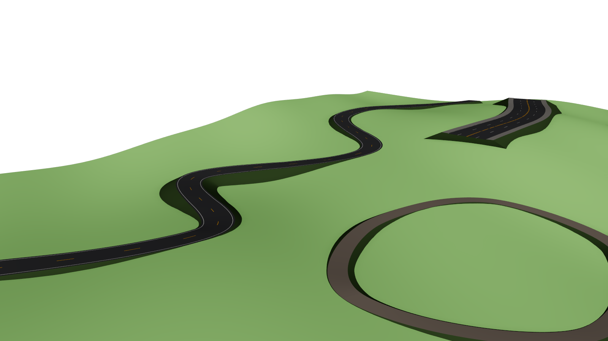
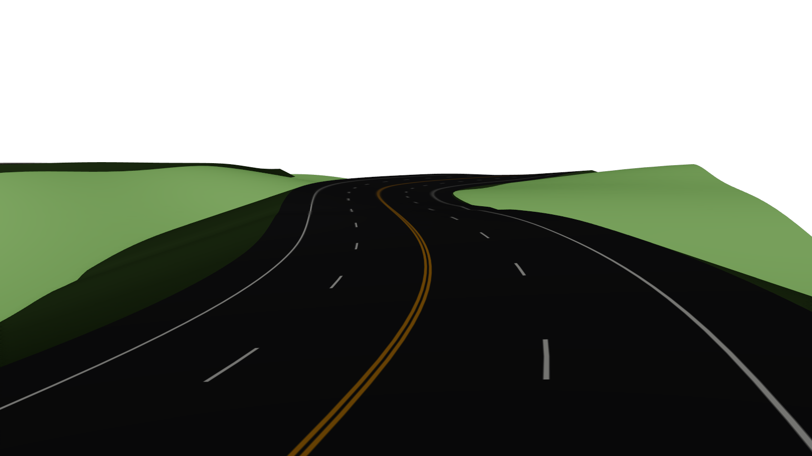
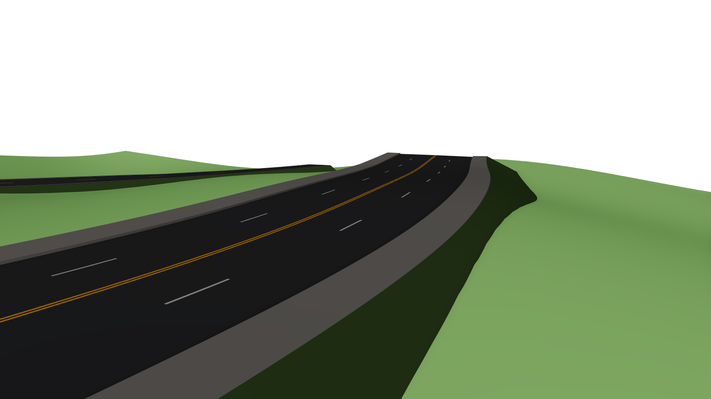
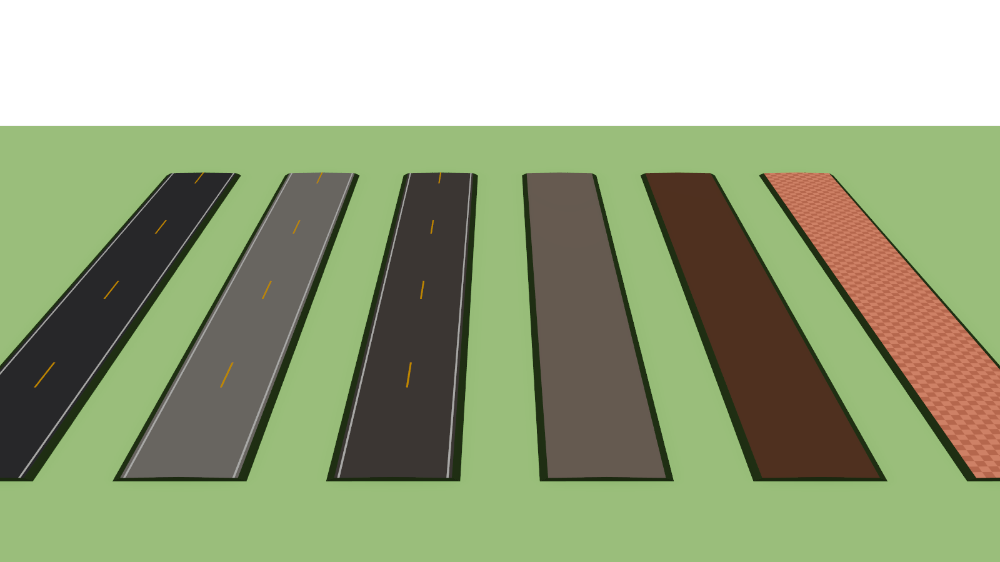
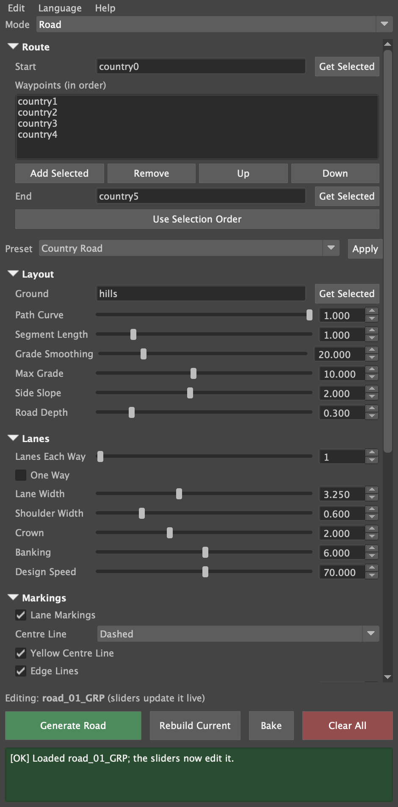

# Maya Procedural Route Tool

<p align="right"><b>English</b> | <a href="README.zh-CN.md">简体中文</a></p>

**Author:** Jianrui(Jerry) Xu

A Maya Python/Qt plugin that builds live geometry along a route of picked objects, locators, vertices or faces. Pick the route once, choose what to build, and move anything on the route afterwards: the build follows.

| Mode | Status | What it builds |
|---|---|---|
| **Cable / Pipe** | ✅ complete | Physically hanging cables, pipes and wire bundles that sag, drape over supports, plug into surfaces along their normals and never pass through the objects they touch |
| **Fence** | ✅ complete | Posts, rails and pickets that step over uneven ground, turn corners with mitred rails, close into yards and hang gates you can animate |
| **Road** | ✅ complete | Roads built like real ones: lanes with a drainage crown, banked curves, smoothed grades over the terrain with embankments, painted markings, curbs and sidewalks, and UVs laid out for lane-marking textures |

Built for SVA *Programming for Animators* (midterm).

| Utility poles | Cyberpunk alley |
|---|---|
|  |  |
| **Picket-fenced yard with its gate swung open** | **Ranch rail curving over a hill** |
|  |  |
| **Wire fence with a double farm gate** | **The whole farm demo** |
|  |  |
| **Country road winding over the hills** | **Highway painted by a texture on its lane UVs** |
|  |  |
| **City street with curbs and sidewalks** | **Road Surface: the built-in materials, and your own** |
|  |  |

## Contents

<table>
<tr>
<td valign="top" width="33%">

<b>🚀 Start here</b>
<ul>
<li><a href="#features">Features</a><ul>
<li><a href="#cable--pipe">Cable / Pipe</a></li>
<li><a href="#fence">Fence</a></li>
<li><a href="#road">Road</a></li>
<li><a href="#every-mode">Every mode</a></li>
</ul></li>
<li><a href="#install">Install</a></li>
<li><a href="#quick-start">Quick start and demo scenes</a></li>
</ul>

</td>
<td valign="top" width="33%">

<b>📖 User guide</b>
<ul>
<li><a href="#the-window">The window</a></li>
<li><a href="#1-pick-a-route">Step by step</a><ul>
<li><a href="#1-pick-a-route">1. Pick a route</a></li>
<li><a href="#2-choose-a-mode-and-a-preset">2. Choose a mode and a preset</a></li>
<li><a href="#3-generate-and-adjust">3. Generate and adjust</a></li>
<li><a href="#4-come-back-to-a-build-later">4. Come back to a build later</a></li>
<li><a href="#5-finish-bake-or-delete">5. Finish: bake or delete</a></li>
</ul></li>
<li><a href="#cable--pipe-settings">Settings</a><ul>
<li><a href="#cable--pipe-settings">Cable / Pipe settings</a></li>
<li><a href="#fence-settings">Fence settings</a></li>
<li><a href="#road-settings">Road settings</a></li>
</ul></li>
<li><a href="#recipes">Recipes</a><ul>
<li><a href="#recipe-wall-pipe">Pipe out of a wall</a></li>
<li><a href="#recipe-power-lines">Power lines</a></li>
<li><a href="#recipe-tangle">Cyberpunk tangle</a></li>
<li><a href="#recipe-yard-gate">Picket yard with a gate</a></li>
<li><a href="#recipe-farm-gate">Wire fence with a farm gate</a></li>
<li><a href="#recipe-railing">Railing on a wall</a></li>
<li><a href="#recipe-country-road">Country road over hills</a></li>
<li><a href="#recipe-city-street">City street</a></li>
<li><a href="#recipe-road-texture">Road painted by a texture</a></li>
</ul></li>
<li><a href="#animating">Animating</a></li>
<li><a href="#languages">Languages</a></li>
<li><a href="#troubleshooting">Troubleshooting</a></li>
</ul>

</td>
<td valign="top" width="33%">

<b>🔧 Under the hood</b>
<ul>
<li><a href="#how-it-works">How it works</a><ul>
<li><a href="#cable--pipe-network-per-wire">Cable / Pipe network</a></li>
<li><a href="#the-cable-solver-cabletoolsolver">The cable solver</a></li>
<li><a href="#fence-network">Fence network</a></li>
<li><a href="#the-fence-builder-fencetoolbuilder">The fence builder</a></li>
<li><a href="#road-network">Road network</a></li>
<li><a href="#the-road-builder-roadtoolbuilder">The road builder</a></li>
<li><a href="#shared-parts">Shared parts</a></li>
</ul></li>
<li><a href="#project-layout">Project layout</a></li>
<li><a href="#testing">Testing</a></li>
<li><a href="#known-limits">Known limits</a></li>
<li><a href="#roadmap">Roadmap</a></li>
<li><a href="#course-record">Course record</a><ul>
<li><a href="#pitch">Pitch</a></li>
<li><a href="#plan">Plan and status</a></li>
<li><a href="#log-cable">Progress log: Cable / Pipe</a></li>
<li><a href="#log-fence">Progress log: Fence</a></li>
<li><a href="#log-gates">Progress log: Gates</a></li>
<li><a href="#log-road">Progress log: Road</a></li>
<li><a href="#lessons">Lessons from my previous tool</a></li>
<li><a href="#peer-run">Peer run: Tong Lin</a></li>
<li><a href="#window-chinese">The window in Chinese</a></li>
</ul></li>
</ul>

</td>
</tr>
</table>

---

## Features
### Cable / Pipe
- **Real hanging shape.** A custom solver node simulates each cable as a rope: fixed length, gravity, bending stiffness and collision with the objects it is attached to. Sag follows horizontal span, so a vertical run hangs straight and the low point of an uneven span moves toward the lower end.
- **Ports.** A single **vertex or face** is a port: the cable plugs in there and leaves along the surface normal, even on a deforming mesh. Mesh waypoints are **draped over** like a cable resting on a support.
- **Wire runs.** One route can carry many wires, side by side like power lines or tangled at random, each with its own slack and thickness (repeatable with a seed).
- **Production details:** Sweep Mesh tube with live radius, sides, twist and taper; end caps; UVs that tile along the length at a set rate; clamps or any custom mesh instanced along each wire.
- **Presets:** Single Pipe, Utility Line, Cyberpunk Tangle.

### Fence
- **Posts where a builder would put them.** At most *Post Spacing* apart, evenly, with a post on every anchor so corners are square. A route that ends where it started closes into a ring, for yards and paddocks.
- **Stands on the ground.** Pick a **Ground** mesh and every post and picket is dropped onto it, so the fence steps over hills and the pickets follow the slope one by one. Move or reshape the ground and the fence follows.
- **Built like a real fence.** Rails are straight lumber from post to post, fixed to the posts' front face (or through them) and **mitred** where the fence turns, so corners close without gaps or overlaps. Pickets are nailed to the front of the rails.
- **Many kinds of fence from one tool:** square or round posts with flat or pointed caps; board rails, or round rails that act as **sagging wires** or **pipe railings**; pickets with any width, gap and point; a curved or straight path.
- **Gates.** Turn any run into a gate between two heavier gate posts, or close the gap at the end of a yard with one. The gate matches its fence: a braced board frame with the fence's pickets, or a tubular steel farm gate on a wire fence, with hinges and a latch, single or double. **Gate Swing** opens it and is keyable, so the gate can be animated; swinging rebuilds only the gate.
- **Your own parts.** Use any mesh as the post or the picket; it keeps its UVs and its hard and soft edges.
- **Wear.** Posts and pickets lean and vary in height for an old fence, repeatable with a seed.
- **Ready to texture:** posts, rails and pickets are separate meshes (one material each), with UVs in scene units and the grain along every board.
- **Presets:** Picket Fence, Ranch Rail, Privacy Fence, Wire Fence, Pipe Railing.

### Road
- **Built like a real road.** Lanes either side of the centre line with a **crown** that drains rain (one-way roads slope to one side), paved shoulders, and optional **curbs and sidewalks**. The cross-section stays level side to side however steeply the road climbs.
- **Banked curves.** Each curve banks (superelevation) from its radius and the **Design Speed**, capped at **Banking** and eased in and out along the road, the way real roads are run off.
- **Over the terrain.** Pick a **Ground** mesh and the road follows it, smoothed over **Grade Smoothing** so it rolls instead of copying every bump, never steeper than **Max Grade**, with rounded crests, and never below the ground. **Side slopes** (embankments) run from its edges down or up to the ground.
- **Lane markings,** modelled: centre line (none, dashed, solid or double solid; yellow or white), lane lines and edge lines, with real dash lengths (3 m dashes, 9 m gaps by default). Gravel and dirt roads get none.
- **UVs for lane-marking textures:** U runs 0–1 across the paved width and V counts dash cycles along the road, so a painted road texture lines up with the lanes and the modelled dashes. (The highway in the gallery is painted entirely by such a texture.)
- **Materials.** Every part (surface, paint, centre line, sidewalks, side slopes) gets its own material. **Road Surface** switches the surface between asphalt, concrete, cobblestone, gravel and dirt, live; **Road Material** puts the surface on your own shader instead.
- **Closed loops** for ring roads and race tracks.
- **Presets:** Country Road, City Street, Highway, One-Way Street, Cobblestone Lane, Gravel Track.

### Every mode
- **Live.** Everything is a Maya node network driven by the anchors' matrices, with no scripts running per frame and no constraints to break. Every setting is also on the build's group in the Channel Box.
- **Any anchor:** objects, locators, groups and joints, vertices and faces; anchors inside moving groups follow too.
- **Load, Rebuild, Bake** (to plain meshes with no history, keeping their materials) and Delete for each build.
- **Five languages:** English, 简体中文, 粵語, Español, Français.
- **Safe to use:** every action is one undo step, errors explain how to fix the problem, and cleanup only ever touches nodes the tool made.

<p align="right"><a href="#contents">↑ Back to contents</a></p>

## Install
Developed and tested in **Maya 2026** on macOS. Earlier versions are untested: Sweep Mesh needs Maya 2022 or later, and the tool also uses newer math nodes such as `multDL`.

1. Download or clone this repository and keep the `CableTool` folder somewhere permanent.
2. Drag `CableTool/install.py` into Maya's viewport. It registers the module, loads the plugin, sets it to auto-load and adds a **Cable Tool** shelf button.

Without installing, you can also load `CableTool/plug-ins/cableTool.py` from **Windows › Settings/Preferences › Plug-in Manager › Browse**.

<p align="right"><a href="#contents">↑ Back to contents</a></p>

## Quick start
1. Open **Cable Tool › Open Cable Tool** from Maya's menu bar.
2. Pick a **Mode**: *Cable / Pipe*, *Fence* or *Road*.
3. Select two or more objects in the order the build should run, then press **Use Selection Order**.
4. Press **Generate**, then move any of the objects: the build follows.

The [User guide](#user-guide) below explains each step in detail.

**Demo scenes:** in the Script Editor, run `exec(open("/path/to/tests/demo_scene.py").read())`. It builds the utility poles and cyberpunk alley. Then call:
- `demo("fence")` for the farm: a picket-fenced yard with a gate, a ranch fence over a hill, a wire fence with a double farm gate, a privacy fence and a pipe railing on a wall.
- `demo("road")` for the countryside: a country road over the hills, a highway painted by a lane texture (the demo paints the texture from the road's own layout), a city street with sidewalks and a gravel track loop.
- `demo("peer")` for the peer-review scene (cone, cube, sphere, cylinder).

<p align="right"><a href="#contents">↑ Back to contents</a></p>

## User guide
### The window


Open it from **Cable Tool › Open Cable Tool** in Maya's menu bar, from the **Cable Tool** shelf button, or by running `cmds.cableTool()`. From top to bottom:

| Part | What it's for |
|---|---|
| **Menu bar** | **Edit:** Reset Settings, Load Selected, Delete Selected, Clear All. **Language:** five interface languages. **Help:** About. |
| **Mode** | What to build: *Cable / Pipe*, *Fence* or *Road*. |
| **Route** | Where to build it: *Start*, an ordered list of *Waypoints* and *End*. |
| **Preset** | Ready-made settings for the chosen mode, applied with **Apply**. |
| **Settings** | Collapsible sections of sliders, tick boxes, dropdowns and pickers. Click a section title to fold it. Hover over any control for a tooltip. |
| **Editing line** | Which build the sliders are editing right now. |
| **Footer** | **Generate**, **Rebuild Current**, **Bake**, **Clear All**. |
| **Status box** | The result of the last action. Green is done, grey is information, amber is a warning that says how to fix it, and red is an unexpected error (details in the Script Editor). |

Every slider has a number field beside it. The slider covers the usual range; type into the field to go further, up to a safe limit.

The window is a Maya panel. It opens floating, on top of Maya but not of other apps. Drag it by its tab into Maya's layout to dock it, for example beside the Attribute Editor; it reopens where you left it, and stays put when you switch language or reload.

<br clear="right">

### 1. Pick a route
A route is an ordered list of **anchors**: *Start*, any number of *Waypoints*, then *End*. An anchor can be:

| Anchor | How the build treats it |
|---|---|
| **Locator, group or joint** | The build passes exactly through its pivot. |
| **Mesh object** | **Cable:** as Start or End, the cable attaches to the surface point facing the next anchor. As a waypoint, it drapes over the top. **Fence:** a post stands at its pivot. **Road:** the centre line passes its pivot. |
| **Single vertex or face** | A **port**. A cable plugs in there and leaves along the surface normal. A fence post stands on that point. It keeps following if the mesh moves or deforms. |

There are three ways to fill the route:
- **All at once (fastest):** in the viewport, click the anchors in the order the build should run (Shift-click to add). Then press **Use Selection Order**. The first becomes Start, the last becomes End, and everything between becomes a waypoint in click order.
- **One field at a time:** select one anchor and press **Get Selected** next to *Start* or *End*.
- **Waypoints:** select one or more anchors and press **Add Selected**. Use **Up** and **Down** to reorder the highlighted waypoint, and **Remove** to drop it.

> **Tip:** to pick a vertex or face, right-click the mesh, choose *Vertex* or *Face*, and click the component. Edges and UVs are ignored, with a note in the status box.

### 2. Choose a mode and a preset
1. Pick the **Mode**. Each mode has its own settings panel and its own presets.
2. Optionally choose a **Preset** and press **Apply**. A preset fills in every setting below it; anything the preset doesn't mention goes back to its default.

| Mode | Presets |
|---|---|
| Cable / Pipe | Single Pipe · Utility Line · Cyberpunk Tangle |
| Fence | Picket Fence · Ranch Rail · Privacy Fence · Wire Fence · Pipe Railing |
| Road | Country Road · City Street · Highway · One-Way Street · Cobblestone Lane · Gravel Track |

3. A fence or road that should follow terrain needs a ground: select the ground mesh and press **Get Selected** next to **Ground** (in the *Layout* section).

### 3. Generate and adjust
1. Press **Generate** (it reads *Generate Cable*, *Generate Fence* or *Generate Road*). The new build is selected, and the editing line shows its name.
2. **Move anything on the route:** the build follows straight away. That includes moving, rotating or editing anchors, moving their parent groups, and moving or reshaping a picked Ground mesh.
3. **Drag any slider:** the build being edited updates live. A whole drag is one undo step.
4. **Use the Channel Box:** every setting is also an attribute on the build's group (for example `fence_01_GRP`). You can set, connect or key it there like any other channel.

Almost every setting is live. Two cable settings, **Wire Count** and **Clamp Count**, change how many nodes there are. They rebuild the cable in place when you release the slider, and the status box says so.

Each Generate makes a new build. To change the route of an existing build, edit the Route fields and press **Rebuild Current**. Rebuild Current also applies a newly picked Ground, Post Mesh, Picket Mesh, Clamp Mesh or Road Material.

### 4. Come back to a build later
- **Load Selected** (Edit menu): select any part of a build (its mesh, curve or group) and choose *Load Selected*. The window switches to that build's mode and fills in its route, settings and picked meshes. The sliders then edit it. This works in a later session too, because everything is stored on the build's group.
- **Reset Settings** (Edit menu): puts every setting of the current mode back to its default and applies it to the build being edited.

### 5. Finish: bake or delete
- **Bake:** turns the build being edited into plain meshes with no history, in a new `<name>_baked_GRP`, and removes the live setup. Use it when the layout is final or the scene leaves Maya. **Ctrl+Z** brings the live build back.
- **Delete Selected** (Edit menu): removes the selected builds.
- **Clear All:** removes everything the tool made, after asking. Your own objects are never touched, even ones with similar names.

Every action is a single **Ctrl+Z**.

### Cable / Pipe settings
| Section | Setting | What it does |
|---|---|---|
| **Shape** | Radius · Profile Sides | Tube thickness, and how many sides it has. |
| | Length Detail | Rings per tube diameter along the length. Raise it for smoother bends. |
| | Twist · Taper | Rotation of the profile from start to end, in degrees; end radius as a multiple of the start. |
| **Path** | Sag | Slack, as a fraction of each span's horizontal length. 0 = taut. A vertical run hangs straight. |
| | Stiffness | 0 = a limp rope, 1 = a stiff hose that bends in wide curves. |
| | Corner Smoothing | How smoothly the cable turns at waypoints. |
| | Smoothness | How finely the cable is simulated. Higher follows contact more closely, but is slower. |
| | Drape Over Mesh Waypoints | Rest on top of mesh waypoints, like a cable over a support. |
| **Wires** | Wire Count · Spread | How many wires run along the route, and how far apart they meet each anchor. |
| | Spread In A Row | On: parallel, like power lines on a crossarm. Off: a random tangle. |
| | Slack / Thickness Variation · Seed | How much each wire differs from the others, and which random pattern is used. |
| **Ends** | Attach Ends to Surface · Lead-out Length | Mesh ends start on the surface, and keep heading out of it for this distance before hanging. |
| **Surface** | End Caps · Texture Repeat per Unit | Closed tube ends; texture tiles per scene unit along the cable. |
| **Hardware** | Clamp Mesh · Clamp Count · Clamp Size | Clamps riding each wire: your own mesh or a plain ring, how many, and how big relative to the wire. |

A **Clamp Mesh** should be modelled at the origin around a tube of radius 1 lying along +X. It is instanced along the wire, never copied or deleted.

### Fence settings


| Section | Setting | What it does |
|---|---|---|
| **Layout** | Ground | A mesh to stand on. Each post and picket is dropped onto it. |
| | Post Spacing | The most distance between posts. Each run is divided evenly. |
| | Post At Every Anchor | On: a post on every anchor, so corners are square. Off: posts evenly along the whole route. |
| | Path Curve | 0 = straight runs between anchors, 1 = a smooth curve through them. |
| | Rails On Other Side | Mounts rails and pickets on the other face of the posts. |
| **Posts** | Post Mesh | Your own post (see below). |
| | Post Height · Post Width | Size above the ground. |
| | Round Posts · Post Cap | Logs or poles instead of square posts; a pointed top on square posts. |
| **Rails** | Rail Count · Lowest / Highest Rail | How many rails, spread evenly between two heights above the ground. 0 = posts only. |
| | Rail Size · Rail Thickness | Board height (or wire/pipe diameter) and board thickness. |
| | Round Rails · Rail Sag | Wires or pipes instead of boards, and how much they droop. |
| | Rails Through Posts | Rails run through the posts' middle instead of across their front. |
| **Pickets** | Picket Mesh | Your own picket (see below). |
| | Pickets | Fills each span with upright pickets. |
| | Height · Width · Gap · Thickness · Point | Picket size, spacing and how pointed the tops are. Gap 0 = a solid privacy fence. |
| **Gate** | Gate After Anchor | The run from anchor N to N + 1 becomes a gate (Start = 1). 0 = no gate. |
| | Double Gate · Hinge On Other Post | Two leaves meeting in the middle; which post a single gate hangs from. |
| | Gate Swing | How far the gate is open, in degrees. Keyable. |
| **Surface** | Wear · Seed · Texture Repeat per Unit | Leaning, uneven posts and pickets for an old fence; texture tiling. |

**Things to know:**
- **Heights are above the ground,** so a 1.2 m post is 1.2 m tall on a slope too. Without a Ground mesh, the fence runs at the anchors' height.
- **Posts and pickets are added and removed live** as the fence gets longer or shorter.
- **Closing a ring:** to make a ring with no gap, end the route on the same anchor it started from.
- **Your own Post Mesh:** model it standing on the origin, facing +X.
- **Your own Picket Mesh:** model it standing on the origin, facing +Z.
- **Scaling your meshes:** each is scaled to Post Height or Picket Height, and keeps its UVs and hard and soft edges.
- **Separate meshes:** posts, rails, pickets and the gate are separate meshes (`<name>_posts_geo` and so on), so each can have its own material.

<br clear="right">

### Road settings


Lengths are in metres (one scene unit = 1 m), as in the real-world defaults below.

| Section | Setting | What it does |
|---|---|---|
| **Layout** | Ground | A mesh for the road to run over. |
| | Path Curve | 0 = straight runs between anchors, 1 = a smooth curve through them (the default: roads are built as curves). |
| | Segment Length | Distance between cross-sections. Curves get more automatically, so their outer edge stays smooth. |
| | Grade Smoothing | With a Ground: how far the rise and fall is smoothed, so the road rolls over the terrain. |
| | Max Grade | With a Ground: the steepest climb, in percent (highways under ~6, country roads 10–12). Steeper ground is crossed on an embankment. |
| | Side Slope · Road Depth | Embankment slope (horizontal per vertical: 2 = 1-in-2); how deep the bed is where there's no Ground. |
| **Lanes** | Lanes Each Way · One Way | Lanes per direction; one-way roads have no centre line and slope to one side. |
| | Lane Width · Shoulder Width | About 3–3.75 m lanes; paved strip outside them. |
| | Crown | Cross-fall for drainage, in percent: about 2 paved, 4 gravel or dirt. |
| | Banking · Design Speed | Most a curve may bank, in percent; the speed that sets how much each curve banks. 0 = flat. |
| **Markings** | Lane Markings | Paint on or off. Never drawn on gravel or dirt. |
| | Centre Line | None, Dashed (overtaking allowed), Solid or Double Solid. |
| | Yellow Centre Line · Edge Lines | Yellow (North America) or white (Europe); solid lines along the lanes' outer edges. |
| | Line Width · Dash Length · Dash Gap | Paint width (0.1–0.15 m); 3 m dashes with 9 m gaps by default. |
| **Sidewalks** | Sidewalks · Curb Height · Sidewalk Width | A curb (about 0.15 m) and a sidewalk on each side, sloping 2% toward the road. |
| **Surface** | Road Material | Your own material for the road surface (see below). |
| | Road Surface | Asphalt, Concrete, Cobblestone, Gravel or Dirt: the built-in material's colour and roughness, live. |

**Things to know:**
- **Changing the road's material:**
  - **Built in:** pick a **Road Surface**. The colour updates live; gravel and dirt also drop the paint, since paint doesn't hold on them.
  - **Your own:** select a material in the Hypershade (or any object that uses it), press **Get Selected** next to **Road Material**, then **Rebuild Current**. The surface goes on that material; the paint, sidewalks and side slopes keep theirs. Clear the field and Rebuild to go back.
  - **Per part:** every part is its own mesh with its own material (`<name>_surface_MTL`, `_markings_MTL`, `_centreLine_MTL`, `_sidewalks_MTL`, `_verge_MTL`), which you can edit or reassign like any other.
- **Texturing lane markings:** the surface's UVs run U 0 → 1 across the paved width (left edge to right edge, shoulders included) and V one unit per dash cycle (Dash Length + Dash Gap), with each dash starting at V = 0. Paint one dash cycle of the road's cross-section into a texture, turn **Lane Markings** off, and pick the material as **Road Material**. `lane_texture()` in `tests/demo_scene.py` paints such a texture from a road's own settings. Paint, sidewalks and side slopes have UVs in metres.
- **Over a Ground,** the road is never lower than the ground under it. Where the terrain dips it is carried on an embankment; where it rises it climbs no steeper than Max Grade. Real roads also cut through hills, but Maya would draw the terrain over a road sunk into it, so this tool raises rather than cuts.
- **Without a Ground,** the road follows the anchors' heights, and its bed drops by Road Depth at the sides.
- **Closing a loop:** end the route on the anchor it started from.
- **Very tight bends:** on a bend tighter than half the road's width, the inside lanes pinch to a point rather than fold over. No real road turns that tight; spread the anchors out.
- **Separate meshes:** `<name>_surface_geo`, `_markings_geo`, `_centreLine_geo`, `_sidewalks_geo` and `_verge_geo` (side slopes and end caps).

<br clear="right">

### Recipes
<a id="recipe-wall-pipe"></a>

<details open>
<summary><b>A pipe coming out of a wall</b></summary>

1. Mode *Cable / Pipe*, preset *Single Pipe*.
2. Select a **face** on the wall, then the object the pipe goes to, and press **Use Selection Order**.
3. Generate. The pipe leaves the wall at a right angle. Raise **Lead-out Length** for a longer straight section before it bends.
4. For brackets: raise **Clamp Count**. To use your own bracket, pick it as **Clamp Mesh** and press **Rebuild Current**.
</details>

<a id="recipe-power-lines"></a>

<details>
<summary><b>Power lines across utility poles</b></summary>

1. Mode *Cable / Pipe*, preset *Utility Line*.
2. Select the crossarms or pole tops in order and press **Use Selection Order**. The middle poles become draped waypoints.
3. Generate. Set **Wire Count** to the number of lines and **Spread** to the crossarm's width.
</details>

<a id="recipe-tangle"></a>

<details>
<summary><b>A cyberpunk wire tangle</b></summary>

1. Mode *Cable / Pipe*, preset *Cyberpunk Tangle*.
2. Pick faces on two building walls (and optionally a pipe or sign in between as a waypoint), then Generate.
3. Change **Seed** until the tangle looks right, and raise **Slack Variation** for more chaos.
</details>

<a id="recipe-yard-gate"></a>

<details>
<summary><b>A picket-fenced yard with a gate</b></summary>

1. Create locators at the yard's corners, plus one locator on each side of where the gate should go, about 1.2 m apart.
2. Select them in order, starting at one gate locator, going round the corners and ending at the other gate locator. Press **Use Selection Order**.
3. Mode *Fence*, preset *Picket Fence*. Pick the terrain as **Ground**.
4. Generate, then set **Gate After Anchor** to the number of the last anchor. The gate closes the gap.
5. If the pickets face into the yard, tick **Rails On Other Side**. Drag **Gate Swing** to open the gate.
</details>

<a id="recipe-farm-gate"></a>

<details>
<summary><b>A wire fence with a farm gate across a field</b></summary>

1. Create locators along the fence line, with two of them 3–4 m apart where the gate goes.
2. Select them in order and press **Use Selection Order**. Choose mode *Fence*, preset *Wire Fence*, and pick the field as **Ground**.
3. Generate. Set **Gate After Anchor** to the number of the first gate locator, and tick **Double Gate**.
4. Raise **Wear** for old, leaning posts.
</details>

<a id="recipe-railing"></a>

<details>
<summary><b>A railing along the top of a wall</b></summary>

1. Create two locators on top of the wall and parent them to the wall, so the railing moves with it.
2. Choose mode *Fence*, preset *Pipe Railing*, with no Ground. The posts stand at the locators' height.
3. Generate, then adjust **Post Spacing** and **Rail Count**.
</details>

<a id="recipe-country-road"></a>

<details>
<summary><b>A country road over the hills</b></summary>

1. Create locators along the line the road should take. A few are enough: the road curves through them.
2. Select them in order, press **Use Selection Order**, choose mode *Road* and preset *Country Road*, and pick the terrain as **Ground**.
3. Generate. The road follows the hills, rounded over crests and on embankments over the dips.
4. For gentler, more highway-like grades, lower **Max Grade** and raise **Grade Smoothing**. Raise **Design Speed** to bank the curves more.
</details>

<a id="recipe-city-street"></a>

<details>
<summary><b>A city street with sidewalks</b></summary>

1. Choose mode *Road*, preset *City Street* (two lanes each way, double yellow line, curbs and 2.5 m sidewalks).
2. Pick the route and Generate. For one-way traffic, tick **One Way**.
3. For a European look, untick **Yellow Centre Line**, set **Centre Line** to *Dashed* and shorten **Dash Gap**.
</details>

<a id="recipe-road-texture"></a>

<details>
<summary><b>A road painted by your own texture</b></summary>

1. Build the road and note its lanes, shoulders and dash cycle.
2. Paint one dash cycle of the cross-section into an image: left paved edge at the left of the image, right edge at the right, the dash starting at the bottom. Or call `lane_texture(settings, path)` from `tests/demo_scene.py`.
3. Make a material with the image, select it in the Hypershade and press **Get Selected** next to **Road Material**.
4. Untick **Lane Markings** and press **Rebuild Current**. The painted lines follow the lanes round every curve and repeat with the dash cycle.
</details>

### Animating
Settings are ordinary channels on the build's group, so any of them can be keyed in the Channel Box. Typical uses:
- **Opening a gate:** key **Gate Swing**, for example 0 at frame 1 and −90 at frame 24. Only the gate is rebuilt each frame, so playback stays fast.
- **A cable pulled tight:** key **Sag**.
- **A fence or road being built:** key or animate the End anchor, and posts (or the road) appear as it moves.

Keys survive **Rebuild Current**, and a rebuild caused by Wire Count or Clamp Count.

### Languages
The tool speaks English, 简体中文, 粵語, Español and Français. Switch from the window's **Language** menu. The window rebuilds in place and keeps the route, the settings and the build being edited. Until you choose, the tool follows Maya's own interface language. Your choice is remembered.

### Troubleshooting
| The status box says… | What to do |
|---|---|
| *Set both a Start and an End anchor* | Fill both fields, or select at least two anchors and press **Use Selection Order**. |
| *'…' is not an object or locator in the scene* | The anchor was renamed or deleted. Pick it again with **Get Selected**. |
| *'…' is used twice in a row* | Two neighbouring anchors are the same object. Remove one of them. |
| *… isn't loaded, and the cable solver / fence builder / road builder lives in it* | Load `cableTool.py` in **Windows › Settings/Preferences › Plug-in Manager**. |
| *Could not load Maya's 'sweep' plugin* | Enable **sweep** in the Plug-in Manager (cables need it). |
| *Nothing to rebuild / bake yet* | Generate first, or select a build and use **Edit › Load Selected**. |
| *'…' has no mesh, so it can't be used as Ground* | Pick a polygon mesh for Ground, Post Mesh, Picket Mesh or Clamp Mesh. |
| *'…' is not a material and has none assigned, so it can't be used as Road Material* | Select the material itself in the Hypershade, or an object that has it assigned. |

- **A build is invisible:** two neighbouring anchors may sit on the same spot. Move one; the status box warns about this on Generate.
- **Maya won't unload the plugin:** it can't while any cable, fence or road exists, even in the undo queue. Start a new scene first.
- **A road sits high above a valley or a hillside:** that's the embankment that keeps it above the ground and within Max Grade. Route it along the hillside, or raise Max Grade.

<p align="right"><a href="#contents">↑ Back to contents</a></p>

## How it works
### Cable / Pipe network (per wire)
```
anchor.worldMatrix ─┐
anchor mesh.outMesh ┼─▶ cableToolSolver ─▶ nurbsCurve ─▶ sweepMeshCreator ─▶ polyMoveUV ─▶ mesh
cable group settings┘          │                │
                               └─▶ outRadius     └─▶ pointOnCurveInfo ─▶ clamp instances
```
The cable's group holds every setting as a keyable attribute wired into each wire's solver and Sweep Mesh. A run with several wires has one such network per wire.

#### The cable solver (`cableToolSolver`)
A Python API 2.0 `MPxNode` registered by the plugin. Every time an input changes it works in two stages:

1. **Rest shape (analytic).**
   - **Path points:** mesh ends sit on the surface facing the next anchor; ports use the vertex or face and its normal; draped waypoints sit on top of the object, lifted by the tube radius.
   - **Between points:** a Catmull-Rom spline (blended with straight lines by *Corner Smoothing*) sagging by a catenary weight × *Sag* × the span's horizontal length.
2. **Relaxation (rope physics).**
   - **The chain:** the rest shape becomes a particle chain, about one point per tube diameter, with fixed segment lengths.
   - **Each Verlet step:** applies gravity, then several passes of length constraints, a bending constraint (*Stiffness*) and collision with every mesh the cable is attached to. Path points and a straight *Lead-out Length* off each mesh end are pinned.
   - **Speed:** the previous result warm-starts the next solve, so dragging is fast.

Tuned on a test cable to keep length within about 1% and bends no tighter than a few tube radii. Measured in Maya 2026 on the peer-review scene: no cable passes through any object, lengths stay within ~1.5%, and the tightest bends are 1.7–4.8 tube radii.

#### Other cable parts
- **Tube:** Sweep Mesh in *Distance* interpolation, a ring every tube diameter ÷ *Length Detail*, so it is smooth at any scene scale. Twist is shown in degrees and converted to the whole turns Sweep Mesh uses.
- **UVs:** Sweep Mesh's *Unfold* UVs (V along the cable, U around it, square texels) scaled by the live arc length (`curveInfo`) × *Texture Repeat per Unit*, so a striped texture tiles at the same density on every cable.
- **Wire runs:** each wire draws from its own random stream (Seed + wire index). In a row, wires stay parallel across *Spread*; in a cluster, each lands at a random spot at every anchor, so they cross.
- **Clamps:** `pointOnCurveInfo` gives each clamp its position and tangent, two cross products and a `fourByFourMatrix` turn that into a frame along the cable, and the scale follows the wire's radius × *Clamp Size*.

### Fence network
```
anchor.worldMatrix (+ mesh for a vertex/face) ─┐
ground.outMesh + ground.worldMatrix ───────────┤                    ┌─▶ outPosts   ─▶ <name>_posts_geo
post / picket mesh.outMesh ────────────────────┼─▶ fenceToolBuilder ┼─▶ outRails   ─▶ <name>_rails_geo
fence group settings ──────────────────────────┘                    ├─▶ outPickets ─▶ <name>_pickets_geo
                                                                    └─▶ outGate    ─▶ <name>_gate_geo
```
#### The fence builder (`fenceToolBuilder`)
A second `MPxNode` that makes the meshes itself, rather than with Sweep Mesh, so the number of posts and pickets can change live while an anchor is dragged. Every time an input changes it:

1. **Lays out the path:** straight runs between anchors, blended toward a Catmull-Rom curve by *Path Curve*, sampled densely for arc length. A closed route also curves smoothly through its start.
2. **Places the posts:** each run between anchors is divided into equal gaps no longer than *Post Spacing* (or the whole route, with *Post At Every Anchor* off). With a Ground mesh, a ray straight down (and up) through each post finds the ground; posts go half a post width into it so slopes never show a gap. *Wear* tilts each post's axis and varies its height from its own random stream (Seed + post number), so adding a post at the end never reshuffles the others.
3. **Joins them with rails:** every rail runs from post to post at its height up the post's axis (so rails follow a leaning post), stepped out to the front face. At a post where the fence turns, both rails step out along the **mitre** (the bisector of the two spans' sides, scaled by 1 ÷ cos of half the turn, capped for very sharp turns), so their ends meet exactly. Board rails are boxes with mitred ends; round rails are tubes that sag on a parabola.
4. **Fills the spans with pickets:** evenly spread over each span at *Picket Width* + *Picket Gap*, each dropped onto the ground on its own and nailed in front of the rails. A picket is its outline (with a point if *Picket Point* > 0) extruded by *Picket Thickness*.
5. **Hangs the gate:** the gate's run gets no posts in between, its two posts are 1.4× thicker and set upright (no wear, or the gate would bind), and the run gets no rails or pickets. The gate is built in its own frame (X from the hinge across the opening, Y up, Z to the front):
   - **Size:** the opening between the gate posts less a gap at each side. It hangs level, clearing the higher of its two posts' ground.
   - **Board gate:** two stiles, a rail at each of the fence's rail heights, and a brace running from the bottom of the hinge side up to the latch side. That is the way round that holds the latch end up.
   - **Tubular gate:** with Round Rails, a steel gate made of tubes instead.
   - **Pickets** in the fence's style, **hardware** (a T-hinge strap and barrel at the top and bottom rails, a latch on the free end), and for a double gate a second leaf hinged on the other post.
   - **Swing:** the frame is rotated by *Gate Swing* about the hinge.

**Swinging is cheap.** *Gate Swing*, *Double Gate* and *Hinge On Other Post* affect only `outGate` (`attributeAffects`). When only the gate is dirty, the node rebuilds just the gate from the layout it kept from its last full build, in about 1.4 ms instead of rebuilding the whole fence. Keyed gate animation plays at about 8 ms a frame in the demo, including the viewport.

**Mesh details:**
- **Boards** get their own vertices per face, so their edges are hard. **Round parts** share vertices round their sides, so they shade smooth.
- **UVs** are each face's corners in scene units × *Texture Repeat per Unit*, with U along the board, so wood grain runs the length of every rail and picket.
- **Custom Post / Picket meshes** are copied in with their UVs and locked normals, so their hard and soft edges survive.
- **Speed:** face building uses plain Python maths on 3-vectors instead of numpy calls, which made the yard fence (1,300 parts) about 3× faster to drag.

### Road network
```
anchor.worldMatrix (+ mesh for a vertex/face) ─┐                   ┌─▶ outSurface    ─▶ <name>_surface_geo
ground.outMesh + ground.worldMatrix ───────────┼─▶ roadToolBuilder ┼─▶ outMarkings   ─▶ <name>_markings_geo
road group settings ───────────────────────────┘                   ├─▶ outCentreLine ─▶ <name>_centreLine_geo
                                                                   ├─▶ outSidewalks  ─▶ <name>_sidewalks_geo
                                                                   ├─▶ outVerge      ─▶ <name>_verge_geo
                                                                   └─▶ outSurfaceColor, outSurfaceRoughness,
                                                                       outCentreColor ─▶ the built-in materials
```
#### The road builder (`roadToolBuilder`)
A third `MPxNode`, built like the fence builder. Every time an input changes it:

1. **Lays out the centre line:** anchors joined by a Catmull-Rom curve (*Path Curve*), resampled at *Segment Length*. Each stretch counts as its length plus the road's half-width × how far it turns, so bends get more cross-sections and the outer edge stays smooth.
2. **Banks the curves:** curvature from the change of heading per metre, smoothed over about 30 m; superelevation = ½ v² / (127 R) (v in km/h, R in m: half the sideways pull taken by banking), capped at *Banking* and eased in and out. On a two-way road the outer half rotates from its crown through flat to the bank, then the whole road tilts as one plane, the way real superelevation is run off.
3. **Sets the height:** without a Ground, the curve's own height. With one:
   - **Need:** at each station, the ground under five points across the paved width, less the cross-section's own fall there, plus 3 cm, gives the lowest the centre line may be.
   - **Grade:** raised (never lowered) until no step climbs faster than *Max Grade*.
   - **Smoothing:** averaged over *Grade Smoothing* and lifted back to the need, many times, which converges on a smooth profile that stays above the ground.
   - **Crests:** smoothing leaves a point where the profile is held up by a crest. What smoothing shaved off is added back as a smooth bump, so crests become rounded vertical curves (the grade changes by at most about 1.4% per metre in the tests).
4. **Builds the meshes:** a level cross-section at every station (lanes, crown, shoulders; then curbs and sidewalks) on the horizontal side vector, so a climbing road never tilts sideways. Side slopes run from the outer edge at *Side Slope* to wherever they meet the ground (a few ray casts per station). Open ends are closed with the cross-section.
5. **Paints the markings:** each line is a strip a few millimetres above the surface, following its crown and bank; dashes are cut at exact arc lengths along the road.

**Materials** come from the node too: `outSurfaceColor` and `outSurfaceRoughness` follow *Road Surface*, and `outCentreColor` follows *Yellow Centre Line*. Those outputs depend only on those settings, so switching the surface recolours the material without rebuilding a mesh. On Bake the materials are kept, holding their last colours.

**UVs:** the surface's U is (offset across + half the paved width) ÷ the paved width; V is the distance driven (including the climb) ÷ the dash cycle. A drag on the 360 m demo country road updates in about 40 ms.

### Shared parts
- **Rebuild keeps animation:** keys or other connections driving a build's settings are unplugged before Rebuild deletes the old group and plugged into the new one, so an animated Gate Swing or Sag survives. A build made by an older version reads newer settings as their defaults, and the first change to one rebuilds it with them.
- **Settings with named choices** (*Centre Line*, *Road Surface*) are enum attributes on the group, so the Channel Box shows their names, and dropdowns in the window.
- **Modes:** `generators.GENERATORS` lists every mode. The dropdown, the settings panels, the pickers and the Generate button are built from it. A mode declares its settings, presets and picked meshes, and builds its own network; the shared base handles the group, stored settings, anchors, Load, Rebuild, Bake and Delete.
- **Scene safety:**
  - **Undo:** one undo chunk per action, and a whole slider drag is a single Ctrl+Z.
  - **Errors:** limits the tool enforces become warnings that say how to fix them, and a catch-all keeps unexpected errors out of Maya.
  - **Input:** every value is sanitised (empty, text, NaN, infinity).
  - **Cleanup:** every created node is tagged, so Clear All and Delete never touch the artist's own nodes, even ones with similar names.
- **Languages:** every artist-facing string goes through `tr()` with the English text as its key. `locales/<code>.json` holds each translation, and anything missing falls back to English. Messages are whole sentences with `{0}` placeholders, so each language can order its words naturally.
  - **Chinese** uses the names from Maya's own Chinese interface.
  - **Cantonese** is written colloquial Cantonese in Traditional characters.
  - **Spanish and French** keep Maya's panel names in English, because Maya has no interface in those languages.

<p align="right"><a href="#contents">↑ Back to contents</a></p>

## Project layout
```
CableTool/                       the Maya module (point Maya here)
├── CableTool.mod
├── install.py                   drag-and-drop installer
├── icons/cableTool.png          menu / shelf icon
├── plug-ins/cableTool.py        plugin entry point: command, the three nodes, menu
└── scripts/cable_tool/          the tool, as a Python package
    ├── config.py                settings table (defaults, ranges, tips), sanitising
    ├── solver.py                cableToolSolver: rest shape + rope physics
    ├── fence.py                 fenceToolBuilder: fence layout and meshes
    ├── road.py                  roadToolBuilder: road layout, profile and meshes
    ├── route.py                 anchors: objects, locators, vertices, faces
    ├── nodes.py                 tagging, cleanup, undo, Sweep Mesh plugin
    ├── ui.py                    the Qt window
    ├── menu.py                  the Cable Tool menu in Maya's menu bar
    ├── i18n.py, locales/        languages
    ├── dev.py                   reload helper, list of interface strings
    └── generators/              one generator per mode (registry, base, cable, fence, road)
README.md, README.zh-CN.md       this guide, in English and Simplified Chinese
docs/images/                     screenshots for this README
tests/
├── test_cable_rig.py            68 headless rig, physics, fence, gate, road and language tests
├── test_ui.py                   headless window test
└── demo_scene.py                utility poles, cyberpunk alley, farm, countryside, peer-review scene
```

<p align="right"><a href="#contents">↑ Back to contents</a></p>

## Testing
The tests run headlessly with Maya's Python (replace `maya2026` with your version):
```
MAYAPY=/Applications/Autodesk/maya2026/Maya.app/Contents/bin/mayapy
$MAYAPY tests/test_cable_rig.py
QT_QPA_PLATFORM=offscreen $MAYAPY tests/test_ui.py
```
They cover:
- **Cable physics:** length kept, sag scaling, vertical runs, the low point, draping without cutting through objects, bend limits.
- **Anchors:** ports on vertices and faces, following moves and mesh edits.
- **Wires and hardware:** multi-wire spread and seeds, clamps, UVs, end caps, Bake.
- **Fence:**
  - **Layout:** a post on every anchor, live post counts as an anchor moves.
  - **Geometry:** every part is closed with its faces pointing outward (signed volume), and rails meet exactly at corners.
  - **Ground:** posts stand on a sloped ground and follow it when it moves.
  - **Routes and parts:** closed rings without a doubled post, pickets on and off, custom post meshes, repeatable wear.
  - **Presets and undo:** every preset builds and loads back, and a build is one undo step.
  - **Gates:** a gate in its run between thicker gate posts with no rails behind it, swinging live and from keys, double gates, the closing gate of a yard, keys surviving Rebuild, and a fence from 0.7.0 upgrading when given a gate.
- **Road:**
  - **Cross-section:** width from lanes and shoulders, the crown's fall, a one-way road's single slope, curbs and sidewalks at the right height.
  - **Curves:** banking toward the inside of a curve, capped at Banking; the cross-section maths on its own.
  - **Ground:** never below the ground, never steeper than Max Grade, small bumps smoothed away and crests rounded; side slopes reach the ground; moving the ground moves the road.
  - **Markings and UVs:** dashes at the dash rhythm, centre line styles, paint just above the surface and none on gravel; U 0–1 across, V in dash cycles.
  - **Materials:** Road Surface recolours live; your own material (picked as a material or as an object using it) is used and survives Rebuild, and deleting the road leaves it alone.
  - **Shapes and loops:** every part faces up or out, including the end caps; a closed route makes a loop with no ends.
  - **Presets and Bake:** every preset builds and loads back, and Bake keeps the materials.
- **Scene safety:** undo, cleanup and the installer.
- **Languages:** every string translated in every language, with its placeholders.
- **Window:** a full session in each of the five languages, including building, gating and loading a fence, and building a road, switching its surface from the dropdown, picking a material from the Hypershade and loading it back.

<p align="right"><a href="#contents">↑ Back to contents</a></p>

## Known limits
- **Speed with many wires:** dragging a crossarm that carries dozens of wires re-solves all of them, at about 0.16 s per update in the demo. A picket fence with about 1,300 parts updates in about 0.05 s.
- **Sharp edges:** where a cable bends over a sharp edge, the tube can graze it by up to about a fifth of its radius. It never cuts through.
- **Fence corners:** pickets stop at each corner post, so a very tight corner shows a small gap between the two runs' pickets, as on a real fence. Square posts turn to face the bisector of a corner.
- **Fence ground:** each post and picket is dropped straight down (or up) onto the Ground mesh. Where the ground has no surface under a part, it stays at the route's height.
- **Gates:**
  - **Steep slopes:** a gate hangs level and clears the higher post's ground, so on a steep slope the gap under its low end grows, as on a real gate.
  - **No collision:** a swinging gate doesn't stop at the ground or at nearby fences.
  - **One gate per fence:** for a second gate, build a second fence.
- **Roads:**
  - **Fill only:** over a Ground the road is raised onto embankments but never cut into a hill, because Maya would draw the terrain over it. On a hillside it sits at the level of the uphill edge, so its downhill embankment can be tall. Carving the terrain is a possible later step.
  - **No junctions:** each road is one route; crossings and T-junctions aren't joined.
  - **Scale:** settings are in real-world metres (and banking runs off over about 30 m), so the scene should use 1 unit = 1 m.
  - **Only the surface** has a Road Material picker; the other parts' materials can be edited or reassigned in Maya.
- **Unloading:** Maya won't unload the plugin while any cable, fence or road exists (even in the undo queue). Start a new scene first.
- **Platforms:** tested in Maya 2026 on macOS only.

<p align="right"><a href="#contents">↑ Back to contents</a></p>

## Roadmap
Cables, fences and roads are all built along a route, so the mode architecture lets one tool build all three:

| Building block | Cable / Pipe | Fence | Road |
|---|---|---|---|
| Route, waypoints, live updates | ✅ | ✅ | ✅ |
| Main geometry | ✅ round tube (Sweep Mesh) | ✅ board or round rails | ✅ lanes, shoulders, curbs, sidewalks |
| Parts along the length | ✅ clamps | ✅ posts and pickets | ✅ painted markings |
| Length-wise UVs | ✅ ribbed / striped | ✅ wood grain | ✅ **lane markings** |
| Hard part | ✅ contact and attachment | ✅ uneven ground, corners, animated gates | ✅ terrain following, banking · intersections still to come |

All three modes are built. Possible later steps:
- **Road:** junctions, carving the terrain so roads can cut through hills, bridges, and lamp posts or barriers along the road.
- **Fence:** more than one gate per fence, and stopping a swinging gate at the ground.

---

<p align="right"><a href="#contents">↑ Back to contents</a></p>

## Course record
The midterm's pitch, plan, progress logs with reflections, and peer feedback.

<a id="pitch"></a>

<details>
<summary><b>Pitch</b></summary>

**1. The tool in one sentence.** A Maya Python/Qt plugin that procedurally generates customizable pipes and cables that route through picked objects, locators or mesh components, plug into surfaces along their normals, and stay live as anything they're attached to moves.

**2. The chore it ends.** Drawing CV curves, extruding profiles, rigging endpoints, adjusting sag, placing clamps and fixing UVs by hand takes 15–20 minutes per cable. This tool does it in a few clicks.

**3. The UI.** One window with a pinned footer, collapsible sections, tooltips on every control, sliders with a typed field and a hard safety cap, and a colour-coded status box whose messages say how to fix a problem. See [User guide](#user-guide).

**4. Why it's advanced.** Sweep Mesh core with editable history; live following with no clusters or constraints to break; waypoint routing; component attachment along normals; hardware instanced along the length; length-wise UVs. Since the pitch it has also gained a custom physics solver node, multi-wire runs, five interface languages and a complete Fence mode with its own builder node.

**6. MVP.** A plugin that loads from Maya's Plug-in Manager and opens a Qt UI where selecting two objects generates a Sweep Mesh cable whose ends follow those objects live, with working Radius and Sag sliders.

**7. The riskiest part.** Getting the cable to leave a picked vertex or face cleanly along its normal and stay attached while the mesh deforms, and keeping sag live alongside waypoints without the curve kinking.
</details>

<a id="plan"></a>

<details>
<summary><b>The three weeks: plan and status</b></summary>

**By Oct 13: plugin shell + Sweep foundation** ✅
- Module folder, `cableTool.py` plugin with the `cableTool` command and **Cable Tool** menu.
- Qt UI opened from that menu; Sweep Mesh along a curve between two objects; radius, profile, twist and taper sliders.

**By Oct 20: live rig (core goal)** ✅
- Ends follow their objects live; sag stays live; waypoints.

**By Oct 26: components, hardware, UVs, polish** ✅
- Component attachment along normals, staying attached when the mesh moves or deforms.
- Hardware instanced along the cable, following it live; end caps.
- Length-wise UVs.
- Presets, bake, undo, edge-case error handling, UI polish.
- Packaging: `.mod` file, drag-and-drop installer, shelf icon, clean unload.

**Stretch**
1. ✅ Multi-wire bundles and variation.
2. ✅ Fence mode: posts, rails and pickets. It went past the "flat ground" goal: it stands on uneven ground, closes into rings and takes custom parts.
3. ✅ Road mode: it went past the "flat swept ribbon with lane-marking UVs" goal: lanes with a crown, banked curves, terrain following with embankments, painted markings, sidewalks and selectable materials.
</details>

<a id="log-cable"></a>

<details>
<summary><b>Progress log: Cable / Pipe (0.1–0.6), with reflections</b></summary>

How the cable went from a first Sweep Mesh rig to a physically hanging, multi-wire tool, in the order it happened. Each stage was tested in Maya and changed by what the viewport showed.

**1. The plugin shell and a live rig (Oct 16, weeks 1–2)**
- **Shell:** a Maya module with a Python API 2.0 plugin. It provides the `cableTool` command, a **Cable Tool** menu, a dependency on the *sweep* plugin, and a clean unload.
- **The `cable_tool` package:** one `DEFAULTS` table for every setting, input sanitising, tag-based cleanup, undo chunks, a shared `Route`, and a generator interface.
- **The first rig:** Sweep Mesh along a curve, with `decomposeMatrix` nodes carrying the anchors' positions. Catenary sag was scaled by span length and done entirely in Maya nodes, with no script running per frame.
- **Window and tests:** a PySide6 window with a mode dropdown, route picking, live sliders (one undo step per drag), Load / Delete Selected and a status box. Headless `mayapy` tests covered the rig and the window.

**2. Peer run and the mode architecture (Oct 18 → 0.3.0)**

Tong Lin's peer run found four problems (details under [Peer run](#peer-run)):

| Problem | Fix |
|---|---|
| Twist pinched the tube | Twist was passed in degrees to an attribute that counts whole turns. It is now converted. |
| Cables met at the object's pivot, inside it | Ends sit on the surface facing the next anchor and leave along its normal. |
| Smoothness wasn't live | It became live. |
| Waypoints turned in sharp corners | They are now smoothed with a Catmull-Rom spline and sag that eases out level at each waypoint. |

The same release added the **mode architecture**. `BaseGenerator` owns the group, settings, anchors and Load / Rebuild / Delete, and a registry builds the Mode dropdown. Fence and Road were listed as placeholders.

**3. First live tests in Maya 2026 (Oct 24)**
- **Ends didn't follow their objects.** `closestPointOnMesh` was fed `.worldMesh` and silently ignored the transform. Fed `.outMesh` plus the object's world matrix, the ends follow.
- **The tube folded where it left a cone's side.** The spline cut straight from the lead-out point to the next anchor, bending tighter (0.13) than the tube's radius (0.3). A stand-in neighbour now keeps the spline heading along the surface normal, so the tightest bend became 0.44.

**4. The physics solver (→ 0.4.0)**

A full re-test still showed three problems:
- **Faceted tubes:** Sweep Mesh had put rings only at a few points.
- **Kinks** where cables left a surface.
- **Cutting through:** cables routed over an object ran through it.

Patching each case would have made the spline maths ever more special-cased, so the cable became a **custom solver node** (`cableToolSolver`). It works in two stages:
1. **An analytic rest shape:** surface ends, draped waypoints and catenary sag.
2. **Verlet rope physics:** fixed segment lengths, bending stiffness and collision with the anchor meshes.

Tuning it in Maya found four more problems:

| Found | Change |
|---|---|
| The rope stretched about 9% | Gravity, damping and the number of passes retuned. It now stays within ~1.5%. |
| Cosine-spaced points made the chain buckle into waves | Evenly spaced points, about one per tube diameter |
| Collision let the tube clip corners | Particles kept 1.2 radii off surfaces |
| `MFnMesh.boundingBox` fails on mesh data | Bounds computed from the points |

The tube was switched to Sweep Mesh's *Distance* interpolation, with a ring every tube diameter ÷ Length Detail, so it is smooth at any scale.

**5. Real-world looks: utility poles and cyberpunk tangles (0.4.0)**

The request was cables that look like power lines or a tangle of cyberpunk wiring, not one tube running between three objects. That led to **multi-wire runs**:
- **One route, many wires:** Wire Count, Spread, and wires either in a row or in a random cluster.
- **Variation:** each wire's slack and thickness vary, from its own random stream (Seed + wire index).
- **Presets:** *Single Pipe*, *Utility Line* and *Cyberpunk Tangle*.
- **A demo scene:** four utility poles and an alley.

**6. Production features (0.5.0 → 0.6.0)**
- **Ports:** a picked vertex or face is a socket. The cable leaves along its normal, and a bundle fans out over a wall.
- **End caps and lengthwise UVs:** texture tiling follows the live arc length, through `curveInfo` and `polyMoveUV`.
- **Bake** to plain meshes, plus a **drag-and-drop installer** and shelf icon.
- **Clamps:** an instance of any mesh, oriented by a frame built from the curve's tangent.
- **Five interface languages,** with every string, error message included, translated.

**Measured at the end of this stage (peer-run scene and demo):**
- **No collisions:** no cable passes through any object.
- **Length:** stays within ~1.5%.
- **Bends:** the tightest are 1.7–4.8 tube radii.
- **Speed:** the 45-wire showcase builds in about 3 s, and a drag updates in about 0.16 s.
- **Tests:** 40 rig tests pass.

#### Reflections
- **When a shape has to obey physics, simulate it.** The analytic spline-plus-sag approach got about 80% of the way, and every remaining problem (folds, kinks, cutting through) needed another special case. A small rope simulation, started from that analytic shape, solved all three at once and made new features (draping, ports, wire bundles) easier. The analytic stage still matters: it gives the simulation a good starting point, so it settles fast.
- **Look at the viewport, not just the tests.** The first tests checked exact positions and passed while the tube was visibly faceted and folded. The useful tests turned out to be physical ones: Is the length kept? How tight is the tightest bend? Does any point sit inside an object? Viewport captures after every change caught what the numbers missed.
- **Maya's API has quiet traps.** All four failed silently rather than raising an error:
  - Twist counts **turns**, not degrees.
  - `closestPointOnMesh` given `worldMesh` ignores the transform.
  - Enum names come back **translated** in non-English Maya, so the code uses indices.
  - `MFnMesh.boundingBox` doesn't work on mesh data.

  For each, the lesson is to measure the result rather than trust the attribute name.
- **Put the logic in a node and keep everything live.** Moving the cable's maths into one custom node replaced a growing web of utility nodes. It also kept the promise of the pitch: nothing runs per frame, nothing needs regenerating, and every setting is a Channel Box attribute.
- **The architecture paid for itself.** Building the generator base and the mode registry before they were strictly needed meant Fence later only needed its own node, settings and generator. Load, Rebuild, Bake, undo, cleanup and languages came for free.
- **What I would do differently:**
  - Start with the solver node from the first week, instead of reaching it after the spline approach ran out.
  - Plan for many wires from the start. A run of dozens of wires re-solves every wire on each drag (about 0.16 s), and solving wires together could share work.
  - Keep the solver's Python separate from Maya earlier, so the physics could be tuned without launching Maya.
</details>

<a id="log-fence"></a>

<details>
<summary><b>Progress log: Fence mode (0.7.0)</b></summary>

**Design.** The plan said "posts plus swept rails". Building the fence with Sweep Mesh and instancing would have fixed the number of posts when the fence was built, so dragging an anchor further couldn't add posts. Instead a second plugin node, `fenceToolBuilder`, makes the posts, rails and pickets as three meshes every time an input changes. The rest of the tool (route, settings on the group, Load, Rebuild, Bake, Delete, undo, languages) is shared with Cable / Pipe through the mode architecture, so Fence only had to add its node, its settings and its generator.

**Built:**
- **Layout:** post spacing with a post on every anchor, a straight or curved path, closed rings, and rails on either side.
- **Ground and corners:** Ground mesh drop for posts and pickets, and mitred rails at corners.
- **Parts:** square or round posts with pointed caps; board, wire (sagging) and pipe rails; pickets with points.
- **Customising:** custom post and picket meshes, wear and seed, five presets, translations in all four languages and the farm demo scene.

**Tested in Maya, and what changed:**

| Seen in the viewport | Change |
|---|---|
| The yard's pickets faced inward | The demo builds the yard with *Rails On Other Side*; the option is there for any fence |
| Pipe-railing rails sat in front of the posts | New *Rails Through Posts* option, used by the Pipe Railing preset |
| Square posts looked unfinished on a picket fence | New *Post Cap* (pointed tops), used by the Picket Fence preset |
| Dragging a corner of the 700-picket yard took 0.13 s per update | Face building rewritten without per-face numpy calls: 0.045 s |
| The Clamp Mesh picker's messages only talked about clamps | Picker messages name whichever mesh was picked (Ground, Post Mesh, ...) |

**Checked by tests:** 11 new fence tests (51 in all) and a fence session in the window test. They are listed under [Testing](#testing).
</details>

<a id="log-gates"></a>

<details>
<summary><b>Progress log: Gates (0.8.0)</b></summary>

**Design.**
- **Placing it:** a gate is a run of the route, so placing one needs no new picking: *Gate After Anchor* names the run. On an open route, the last anchor's number means the missing run from End back to Start, which is exactly how a yard with a gate is drawn.
- **Its own mesh:** the gate is a fourth mesh, so it can take its own material.
- **Animation:** *Gate Swing* is a keyable setting on the fence's group, so animators can key the gate opening like any other channel.

**Built:**
- **Gate posts:** heavier and set upright, with the run's rails and pickets left out.
- **Gate styles:** a braced board gate with the fence's pickets, or a tubular steel gate for wire and pipe fences, with T-hinges and a latch.
- **Leaves:** single or double, hinged on either post.
- **Speed:** a gate-only fast path in the node.
- **Rebuild:** keeps keys on settings.
- **Upgrade:** an older fence gains the new settings when you first change one.
- **Wiring:** translations, and the farm demo now has a garden gate and a double farm gate.

**Tested in Maya:**
- **Closed:** the yard gate lines up with the fence, its pickets continue the fence's rhythm and the brace runs from the bottom of the hinge side.
- **Keyed:** Gate Swing from 0° to −95° over 24 frames swings it into the yard at about 8 ms a frame.
- **Farm gate:** the two leaves of the double gate stand open in the wire fence.
- **A bug found and fixed:** looking at a keyed gate in the window raised a question: what happens on Rebuild? Deleting the old group would have deleted its animation. Rebuild now carries keys and connections across, for cables too.

**Checked by tests:** 6 new tests (57 in all) and gate steps in the window test.
</details>

<a id="log-road"></a>

<details>
<summary><b>Progress log: Road mode (0.9.0)</b></summary>

**Design.** The plan said "a flat swept ribbon with lane-marking UVs". A flat ribbon would read as a road from far away, but not up close or over terrain. The goal became a road built the way a road engineer would build it, kept to what a single route can do (no junctions). Like Fence, it is a plugin node (`roadToolBuilder`) that writes its meshes on every change, with the rest of the tool shared through the mode architecture.

**Real-world rules it follows:**

| Real roads | In the tool |
|---|---|
| Lanes are about 3–3.75 m; markings 0.1–0.15 m wide; US dashes 3 m with 9 m gaps | The defaults |
| A crown of about 2% drains rain; gravel and dirt about 4% | *Crown*; the Gravel Track preset uses 4% |
| Curves bank by about v² / 127R, capped (6–8%), and the bank is run off gradually | *Banking* and *Design Speed*, eased over ~30 m |
| The cross-section stays level side to side on a climb | Built on the horizontal side vector |
| Grades are limited (highways ~5%, country roads ~10%), and crests are rounded vertical curves | *Max Grade*, crests rounded |
| Embankments and cuts at about 1-in-2 | *Side Slope* |
| Paint isn't laid on gravel or dirt | No markings on those surfaces |

**Requested during the build: changing the road's material.** That became two options:
- **Road Surface,** a dropdown that recolours the built-in material live, through colour outputs on the node.
- **Road Material,** a picker that takes your own material or an object using it.

To support them:
- **Dropdowns:** the tool gained settings with named choices (enum attributes, shown as dropdowns).
- **Picker:** the picker now accepts materials picked in the Hypershade.
- **Bake:** keeps the materials.

**Tested in Maya, and what changed:**

| Seen in Maya | Change |
|---|---|
| On steep demo terrain the road climbed at 29.5% | New *Max Grade* (10% by default): the profile is raised until no step is steeper |
| Where the road was held up by a crest, the grade flipped from +8% to −8% in one metre | Crests rounded into vertical curves; the tests now check the grade never changes by more than 2% in a metre |
| Fresh-asphalt colour read as black in the viewport | Weathered asphalt (0.09 instead of 0.045) |
| The outer edge of a hairpin was faceted: cross-sections were spaced along the centre line only | Cross-sections spaced by how far the outer edge travels, so bends get more |
| The end of an open road was drawn black | The end cap faced inward; it is oriented by its Newell normal and tested |
| A city street on a hillside sat on a tall embankment | A real limit of not cutting into the ground: documented under Known limits, and the demo's street moved to flatter ground |
| The Road Surface dropdown failed to connect in PySide6 | Connected through a lambda |

**Measured:** a 360 m country road over the hills updates in about 40 ms while an anchor is dragged; the four-road demo builds in about 0.4 s.

**Checked by tests:** 11 new road tests (68 in all) and road steps in the window test, listed under [Testing](#testing).

#### Reflections
- **Real-world rules made better defaults than eyeballing.** Lane widths, dash lengths, crown, banking and grade limits are all published standards. Using them gave a road that looks right at first try, and each setting's tooltip can say what a real value is.
- **The tests caught what the viewport hid.** The 16%-in-a-metre grade flip on crests was hard to see in a wide shot, but a test of the grade's change found it at once. The reverse also happened: the black end cap was obvious in a screenshot and invisible to every test, until I added one.
- **A constraint of the scene shapes the design.** Maya can't hide terrain under a road, so the road can't cut into hills. Making it fill-only was the honest choice, and documenting the tall embankments it causes is better than hiding them.
</details>

<a id="lessons"></a>

<details>
<summary><b>Lessons from my previous tool</b></summary>

In September I built `CableHoseRigTool.py`, a one-shot generator: it computed every point in Python and built meshes with no history, so any change meant clearing and regenerating. This midterm turns that idea into a **live, node-based** tool.

| Keep | Drop | Fix |
|---|---|---|
| Pinned footer, collapsible sections, colour-coded status box | Hand-built coordinate frames (Sweep Mesh orients the tube) | Selection order not guaranteed → `orderedSelection` |
| Actionable messages, tooltips, safety-capped fields | Extrude / cylinder fallback with history off | Generating twice left empty groups; cleanup by name prefix → tag-based cleanup |
| Undo chunks, two-level error handling, input sanitising | | Defaults written twice → one `DEFAULTS` table |
| Sag scaled by span length; catenary shape | | Clear was all-or-nothing → per-cable Load / Delete |
| Multi-pick spans → grown into waypoint routing | | |
</details>

<a id="peer-run"></a>

<details>
<summary><b>Peer run: Tong Lin, and what changed</b></summary>

1. **What I did:** I loaded the plug-in in Maya 2026, picked a cone, a cube, a sphere and a cylinder in order as start, waypoints and end, generated a few cables, and then changed the Twist and Smoothness settings and added more waypoints.
2. **What happened:** The cables were generated and followed the objects, but after changing Twist the tube became kinked and twisted into separate segments instead of a smooth cable, and where the cable meets the start and end objects the tube narrows to a sharp point and the cables cross each other.
3. **What confused me or broke:** Smoothness didn't update live like the other settings (I had to press Rebuild to see it), and when I added several waypoints the cable bent into sharp, tight corners around them instead of a smooth turn.

| Problem | Cause | Fix |
|---|---|---|
| Twist kinked the tube into segments | Sweep Mesh counts Twist in whole turns; the tool passed degrees, so 90 became 90 turns | Degrees are converted to turns |
| The tube narrowed to a point at the end objects, and cables crossed | Every cable ended at the object's pivot, inside it | Ends sit on the surface facing the next anchor and leave outward |
| Smoothness didn't update live | It changed the curve's point count, which needed a Rebuild | The solver re-samples live |
| Sharp corners at waypoints | Straight lines between waypoints, and sag meeting in a V | A smooth spline through waypoints, then rope physics |

A later live re-test in Maya found three more problems:
- **Faceted tubes:** Sweep Mesh's default put cross-section rings only at a few points.
- **Kinks at the surfaces:** cables kinked or folded where they left a surface.
- **Cutting through objects:** cables routed through a mesh waypoint ran through its middle, then cut through its walls.

Those led to the physics solver.

| Before (peer-run scene) | After |
|---|---|
|  |  |
</details>

<a id="window-chinese"></a>

<details>
<summary><b>The window in Chinese</b></summary>


</details>

<p align="right"><a href="#contents">↑ Back to contents</a></p>
