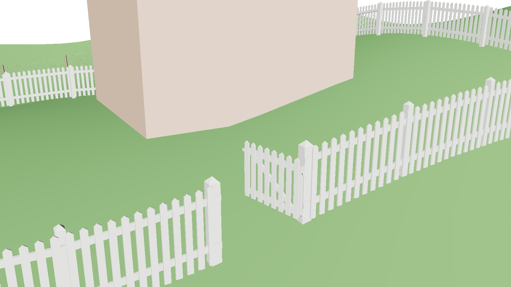
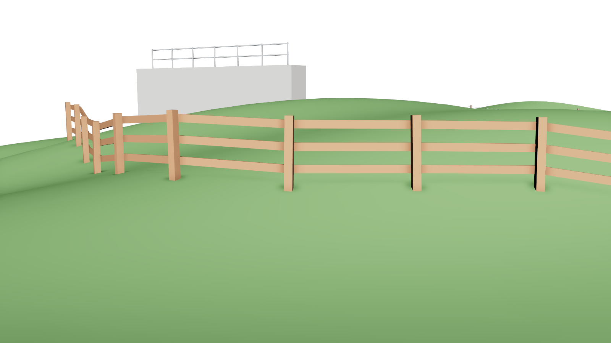
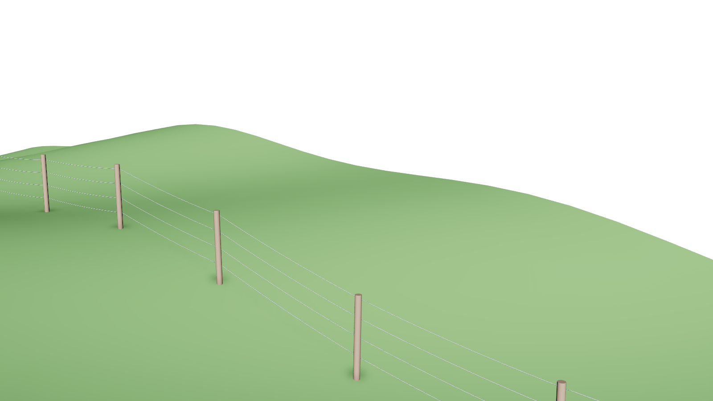
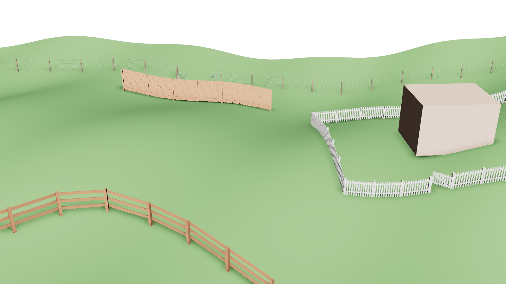
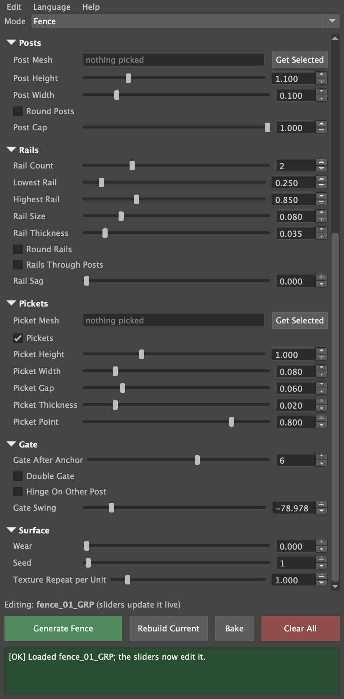

# Maya 程序化路径工具（Maya Procedural Route Tool）

<p align="right"><a href="README.md">English</a> | <b>简体中文</b></p>

**作者：** 徐健睿（Jianrui (Jerry) Xu）

一个 Maya Python/Qt 插件：沿着由所拾取的物体、定位器、顶点或面组成的路径，生成实时更新的几何体。只需拾取一次路径，选择要生成的内容，之后移动路径上的任何东西，生成结果都会跟着变化。

> 工具界面本身支持中文：在窗口的 **Language（语言）** 菜单中选择 *简体中文*。下文中的按钮和设置名称都使用工具中文界面里的名称，并在括号中注明英文名称，方便使用英文界面时对照。

| 模式 | 状态 | 生成内容 |
|---|---|---|
| **线缆 / 管道**（Cable / Pipe） | ✅ 已完成 | 符合物理的悬垂线缆、管道和线束：会下垂、搭在支撑物上、沿法线插入表面，并且永远不会穿过它们接触的物体 |
| **围栏**（Fence） | ✅ 已完成 | 立柱、横栏和尖桩：跨越起伏地面，转角处横栏斜接，可闭合成院子，还能挂上可做动画的门 |
| **道路**（Road） | 计划中 | 带车道线 UV 的扁平条带（在模式下拉菜单中显示为灰色） |

为 SVA《Programming for Animators》课程期中项目而制作。

| 电线杆 | 赛博朋克小巷 |
|---|---|
|  |  |
| **尖桩围栏围起的院子，院门敞开** | **弯曲翻过山坡的牧场栅栏** |
|  |  |
| **带双开农场门的铁丝围栏** | **完整的农场演示场景** |
|  |  |

<a id="contents"></a>

## 目录

<table>
<tr>
<td valign="top" width="33%">

<b>🚀 从这里开始</b>
<ul>
<li><a href="#features">功能</a><ul>
<li><a href="#cable--pipe">线缆 / 管道</a></li>
<li><a href="#fence">围栏</a></li>
<li><a href="#both-modes">两种模式通用</a></li>
</ul></li>
<li><a href="#install">安装</a></li>
<li><a href="#quick-start">快速上手与演示场景</a></li>
</ul>

</td>
<td valign="top" width="33%">

<b>📖 使用指南</b>
<ul>
<li><a href="#the-window">窗口</a></li>
<li><a href="#1-pick-a-route">分步说明</a><ul>
<li><a href="#1-pick-a-route">1. 拾取路径</a></li>
<li><a href="#2-choose-a-mode-and-a-preset">2. 选择模式和预设</a></li>
<li><a href="#3-generate-and-adjust">3. 生成与调整</a></li>
<li><a href="#4-come-back-to-a-build-later">4. 之后回来继续编辑</a></li>
<li><a href="#5-finish-bake-or-delete">5. 收尾：烘焙或删除</a></li>
</ul></li>
<li><a href="#cable--pipe-settings">设置</a><ul>
<li><a href="#cable--pipe-settings">线缆 / 管道设置</a></li>
<li><a href="#fence-settings">围栏设置</a></li>
</ul></li>
<li><a href="#recipes">实例教程</a><ul>
<li><a href="#recipe-wall-pipe">从墙里伸出的管道</a></li>
<li><a href="#recipe-power-lines">电线</a></li>
<li><a href="#recipe-tangle">赛博朋克乱线</a></li>
<li><a href="#recipe-yard-gate">带门的尖桩围栏院子</a></li>
<li><a href="#recipe-farm-gate">带农场门的铁丝围栏</a></li>
<li><a href="#recipe-railing">墙顶栏杆</a></li>
</ul></li>
<li><a href="#animating">制作动画</a></li>
<li><a href="#languages">语言</a></li>
<li><a href="#troubleshooting">问题排查</a></li>
</ul>

</td>
<td valign="top" width="33%">

<b>🔧 原理与实现</b>
<ul>
<li><a href="#how-it-works">工作原理</a><ul>
<li><a href="#cable--pipe-network-per-wire">线缆 / 管道节点网络</a></li>
<li><a href="#the-cable-solver-cabletoolsolver">线缆解算器</a></li>
<li><a href="#fence-network">围栏节点网络</a></li>
<li><a href="#the-fence-builder-fencetoolbuilder">围栏生成节点</a></li>
<li><a href="#shared-parts">共享部分</a></li>
</ul></li>
<li><a href="#project-layout">项目结构</a></li>
<li><a href="#testing">测试</a></li>
<li><a href="#known-limits">已知限制</a></li>
<li><a href="#roadmap">路线图</a></li>
<li><a href="#course-record">课程记录</a><ul>
<li><a href="#pitch">项目提案</a></li>
<li><a href="#plan">计划与进度</a></li>
<li><a href="#log-cable">开发日志：线缆 / 管道</a></li>
<li><a href="#log-fence">开发日志：围栏</a></li>
<li><a href="#log-gates">开发日志：门</a></li>
<li><a href="#lessons">上一个工具的经验</a></li>
<li><a href="#peer-run">同学试用：Tong Lin</a></li>
<li><a href="#window-chinese">中文界面</a></li>
</ul></li>
</ul>

</td>
</tr>
</table>

---

<a id="features"></a>

## 功能
<a id="cable--pipe"></a>

### 线缆 / 管道
- **真实的悬垂形态。** 自定义解算节点把每根线缆当作绳子来模拟：长度固定、受重力、有弯曲刚度，并与它所连接的物体发生碰撞。下垂量取决于水平跨度，所以竖直的一段会笔直下垂，而高低不等的一跨，最低点会偏向较低的一端。
- **接口。** 单个**顶点或面**就是一个接口：线缆从那里插入，并沿表面法线引出，即使网格在变形也一样。网格途经点会被线缆**搭在上面**，就像线缆搭在支撑物上。
- **多线。** 一条路径可以承载很多根线，可以像电线一样并排，也可以随机缠绕，每根线的松弛度和粗细各不相同（用随机种子可复现）。
- **生产细节：** Sweep Mesh 管道，半径、边数、扭转和渐细都可实时调整；端盖；按设定密度沿长度平铺的 UV；卡箍或任意自定义网格沿每根线实例化。
- **预设：** 单根管道（Single Pipe）、电线杆线路（Utility Line）、赛博朋克乱线（Cyberpunk Tangle）。

<a id="fence"></a>

### 围栏
- **立柱放在工匠会放的位置。** 间距不超过 *立柱间距*，均匀分布，每个锚点上都有一根立柱，所以转角是方正的。起点和终点相同的路径会闭合成一圈，用于院子和围场。
- **立在地面上。** 拾取一个**地面**（Ground）网格，每根立柱和尖桩都会落到它上面，所以围栏能跨过山丘，尖桩逐根贴合坡度。移动或修改地面，围栏也会跟着变化。
- **按真实围栏的方式搭建。** 横栏是从立柱到立柱的直木料，固定在立柱正面（或穿过立柱），在围栏转弯处**斜接**，转角既无缝隙也不重叠。尖桩钉在横栏正面。
- **一个工具，多种围栏：** 方形或圆形立柱，平顶或尖顶；木板横栏，或者作为**下垂铁丝**或**管式栏杆**的圆形横栏；宽度、间隙和尖顶都可调的尖桩；弯曲或笔直的路径。
- **门。** 可以把任意一段变成两根加粗门柱之间的门，也可以用门封住院子末端的缺口。门与所在围栏风格一致：带斜撑的木框配上围栏的尖桩，或者铁丝围栏上的钢管农场门，带铰链和门闩，单开或双开。**门的开合角度**（Gate Swing）控制门打开多少，并且可以设置关键帧，所以门可以做动画；开关门时只重建门本身。
- **使用你自己的部件。** 任何网格都可以作为立柱或尖桩，并保留它的 UV 和软硬边。
- **磨损。** 立柱和尖桩会倾斜、高低不一，营造老旧围栏的感觉，用随机种子可复现。
- **可直接贴图：** 立柱、横栏和尖桩是分开的网格（各用一个材质），UV 以场景单位计算，每块木板的纹理都沿木板方向。
- **预设：** 尖桩围栏（Picket Fence）、牧场栅栏（Ranch Rail）、隐私围栏（Privacy Fence）、铁丝围栏（Wire Fence）、管式栏杆（Pipe Railing）。

<a id="both-modes"></a>

### 两种模式通用
- **实时。** 一切都是由锚点矩阵驱动的 Maya 节点网络，没有逐帧运行的脚本，也没有会断掉的约束。每个设置也都作为属性出现在生成结果的组上，可在通道盒中编辑。
- **任何锚点：** 物体、定位器、组和关节、顶点和面；在移动的组里面的锚点也会跟随。
- 每个生成结果都可以**载入、重建、烘焙**（成为没有历史的普通网格）和删除。
- **五种语言：** English、简体中文、粵語、Español、Français。
- **安全可靠：** 每个操作都是一步撤销，错误提示会说明如何解决，清理只会碰工具自己创建的节点。

<p align="right"><a href="#contents">↑ 返回目录</a></p>

<a id="install"></a>

## 安装
在 macOS 上的 **Maya 2026** 中开发和测试。更早的版本未经测试：Sweep Mesh 需要 Maya 2022 或更高版本，工具还用到了 `multDL` 等较新的数学节点。

1. 下载或克隆本仓库，把 `CableTool` 文件夹放在一个固定的位置。
2. 把 `CableTool/install.py` 拖进 Maya 的视口。它会注册模块、加载插件、设为自动加载，并添加一个 **Cable Tool** 工具架按钮。

不安装的话，也可以从 **窗口 › 设置/首选项 › 插件管理器 › 浏览**（Windows › Settings/Preferences › Plug-in Manager › Browse）加载 `CableTool/plug-ins/cableTool.py`。

<p align="right"><a href="#contents">↑ 返回目录</a></p>

<a id="quick-start"></a>

## 快速上手
1. 从 Maya 菜单栏打开 **线缆工具 › 打开线缆工具**（Cable Tool › Open Cable Tool）。
2. 选择一个**模式**：*线缆 / 管道* 或 *围栏*。
3. 按生成的走向依次选择两个或更多物体，然后点击 **使用选择顺序**（Use Selection Order）。
4. 点击 **生成**（Generate），然后移动其中任意一个物体：生成结果会跟着变化。

下方的[使用指南](#user-guide)会详细解释每一步。

**演示场景：** 在脚本编辑器中运行 `exec(open("/path/to/tests/demo_scene.py").read())`。它会生成电线杆和赛博朋克小巷。然后可以调用：
- `demo("fence")` 生成农场：带门的尖桩围栏院子、翻过山坡的牧场栅栏、带双开农场门的铁丝围栏、一道隐私围栏，以及墙上的一段管式栏杆。
- `demo("peer")` 生成同学试用场景（圆锥、立方体、球体、圆柱）。

<p align="right"><a href="#contents">↑ 返回目录</a></p>

<a id="user-guide"></a>

## 使用指南
<a id="the-window"></a>

### 窗口


可以从 Maya 菜单栏的 **线缆工具 › 打开线缆工具**、**Cable Tool** 工具架按钮，或运行 `cmds.cableTool()` 打开。从上到下依次是：

| 部分 | 用途 |
|---|---|
| **菜单栏** | **编辑：** 重置设置、载入所选、删除所选、全部清除。**语言：** 五种界面语言。**帮助：** 关于。 |
| **模式** | 要生成什么：*线缆 / 管道* 或 *围栏*。*道路* 在完成之前显示为灰色。 |
| **路径** | 在哪里生成：*起点*、按顺序排列的 *途经点*，以及 *终点*。 |
| **预设** | 当前模式的现成设置，点击 **应用** 生效。 |
| **设置** | 可折叠的分组，包含滑块、复选框和网格拾取器。点击分组标题可以折叠。鼠标悬停在任何控件上都会显示提示。 |
| **编辑提示行** | 滑块当前正在编辑哪个生成结果。 |
| **底部按钮** | **生成**、**重建当前**、**烘焙**、**全部清除**。 |
| **状态栏** | 上一个操作的结果。绿色表示完成，灰色是信息，琥珀色是警告并会说明如何解决，红色是意外错误（详情见脚本编辑器）。 |

每个滑块旁边都有一个数字输入框。滑块覆盖常用范围；在输入框里输入数值可以超出这个范围，直到一个安全上限。

<br clear="right">

<a id="1-pick-a-route"></a>

### 1. 拾取路径
路径是一组有顺序的**锚点**：*起点*、任意数量的 *途经点*，然后是 *终点*。锚点可以是：

| 锚点 | 生成结果如何处理它 |
|---|---|
| **定位器、组或关节** | 生成结果正好穿过它的枢轴点。 |
| **网格物体** | **线缆：** 作为起点或终点时，线缆连接到朝向下一个锚点的表面点上；作为途经点时，线缆搭在它的顶部。**围栏：** 立柱立在它的枢轴点上。 |
| **单个顶点或面** | 一个**接口**。线缆从那里插入并沿表面法线引出；围栏立柱立在那个点上。网格移动或变形时它会一直跟随。 |

填写路径有三种方法：
- **一次全部填好（最快）：** 在视口中按生成走向依次点击锚点（按住 Shift 加选），然后点击 **使用选择顺序**。第一个成为起点，最后一个成为终点，中间的按点击顺序成为途经点。
- **逐个填写：** 选择一个锚点，然后点击 *起点* 或 *终点* 旁边的 **获取所选**（Get Selected）。
- **途经点：** 选择一个或多个锚点，点击 **添加所选**（Add Selected）。用 **上移** 和 **下移** 调整高亮途经点的顺序，用 **移除** 删掉它。

> **提示：** 要拾取顶点或面，在网格上单击右键，选择 *顶点* 或 *面*，再点击该元素。边和 UV 会被忽略，并在状态栏中提示。

<a id="2-choose-a-mode-and-a-preset"></a>

### 2. 选择模式和预设
1. 选择**模式**。每种模式都有自己的设置面板和预设。
2. 可选：选择一个**预设**并点击 **应用**。预设会填写它下面的所有设置；预设没有提到的设置会恢复为默认值。

| 模式 | 预设 |
|---|---|
| 线缆 / 管道 | 单根管道 · 电线杆线路 · 赛博朋克乱线 |
| 围栏 | 尖桩围栏 · 牧场栅栏 · 隐私围栏 · 铁丝围栏 · 管式栏杆 |

3. 如果围栏要立在地形上，需要指定地面：选择地面网格，然后点击 **地面**（Ground）旁边的 **获取所选**（在 *布局* 分组中）。

<a id="3-generate-and-adjust"></a>

### 3. 生成与调整
1. 点击 **生成**（按钮显示为 *生成线缆* 或 *生成围栏*）。新的生成结果会被选中，编辑提示行显示它的名称。
2. **移动路径上的任何东西：** 生成结果会立刻跟随。包括移动、旋转或编辑锚点，移动它们的父组，以及移动或修改所拾取的地面网格。
3. **拖动任意滑块：** 正在编辑的生成结果会实时更新。一次完整的拖动是一步撤销。
4. **使用通道盒：** 每个设置也都是生成结果所在组（例如 `fence_01_GRP`）上的属性。你可以像其他通道一样在那里设置、连接或设置关键帧。

几乎所有设置都是实时的。有两个线缆设置，**线数**（Wire Count）和 **卡箍数量**（Clamp Count），会改变节点的数量。松开滑块时它们会原地重建线缆，状态栏会说明这一点。

每次点击生成都会创建一个新的生成结果。要修改已有生成结果的路径，先编辑路径栏，再点击 **重建当前**（Rebuild Current）。重建当前也会应用新拾取的地面、立柱、尖桩或卡箍网格。

<a id="4-come-back-to-a-build-later"></a>

### 4. 之后回来继续编辑
- **载入所选**（编辑菜单）：选择生成结果的任意部分（网格、曲线或组），然后选择 *载入所选*。窗口会切换到该生成结果的模式，并填入它的路径、设置和拾取的网格，之后滑块就会编辑它。因为一切都保存在生成结果的组上，所以在之后的会话中也能这样做。
- **重置设置**（编辑菜单）：把当前模式的所有设置恢复为默认值，并应用到正在编辑的生成结果上。

<a id="5-finish-bake-or-delete"></a>

### 5. 收尾：烘焙或删除
- **烘焙：** 把正在编辑的生成结果变成没有历史的普通网格，放在新的 `<名称>_baked_GRP` 中，并删除实时节点网络。在布局定稿或场景要导出 Maya 时使用。**Ctrl+Z** 可以恢复实时版本。
- **删除所选**（编辑菜单）：删除所选的生成结果。
- **全部清除：** 确认后删除工具创建的所有东西。你自己的物体永远不会被碰到，即使名字很相似。

每个操作都只需一次 **Ctrl+Z** 撤销。

<a id="cable--pipe-settings"></a>

### 线缆 / 管道设置
| 分组 | 设置 | 作用 |
|---|---|---|
| **形状** | 半径（Radius）· 截面边数（Profile Sides） | 管道的粗细，以及一圈有多少条边。 |
| | 长度细节（Length Detail） | 沿长度方向每个管道直径的环数。弯曲处需要更平滑时调高。 |
| | 扭转（Twist）· 渐细（Taper） | 截面从起点到终点的旋转角度（度）；终点半径相对起点的倍数。 |
| **路径形态** | 下垂（Sag） | 松弛程度，以每一跨水平长度的比例表示。0 = 绷紧。竖直的一段会笔直下垂。 |
| | 刚度（Stiffness） | 0 = 软绳，1 = 弯曲弧度很大的硬软管。 |
| | 拐角平滑（Corner Smoothing） | 线缆在途经点处转弯的平滑程度。 |
| | 平滑度（Smoothness） | 线缆模拟的精细程度。越高越贴合接触面，但越慢。 |
| | 搭在网格途经点上（Drape Over Mesh Waypoints） | 搭在网格途经点顶部，就像线缆搭在支撑物上。 |
| **线束** | 线数（Wire Count）· 分布范围（Spread） | 沿路径有多少根线，以及它们在每个锚点处分开多远。 |
| | 排成一行（Spread In A Row） | 开：并排，像横担上的电线。关：随机缠绕。 |
| | 松弛变化 / 粗细变化（Slack / Thickness Variation）· 随机种子（Seed） | 每根线之间差异多大，以及使用哪种随机样式。 |
| **端点** | 端点贴附表面（Attach Ends to Surface）· 引出长度（Lead-out Length） | 网格端点从表面开始，并在下垂之前沿表面方向继续引出这段距离。 |
| **表面** | 端盖（End Caps）· 每单位纹理重复（Texture Repeat per Unit） | 封闭管道两端；沿线缆每个场景单位的纹理平铺次数。 |
| **配件** | 卡箍网格（Clamp Mesh）· 卡箍数量（Clamp Count）· 卡箍大小（Clamp Size） | 套在每根线上的卡箍：你自己的网格或一个普通圆环，数量多少，以及相对线的大小。 |

**卡箍网格**应在原点处建模，包住一根沿 +X 方向、半径为 1 的管子。它会沿线实例化，不会被复制或删除。

<a id="fence-settings"></a>

### 围栏设置


| 分组 | 设置 | 作用 |
|---|---|---|
| **布局** | 地面（Ground） | 立在上面的网格。每根立柱和尖桩都会落到它上面。 |
| | 立柱间距（Post Spacing） | 立柱之间的最大距离。每一段都会被均分。 |
| | 每个锚点放立柱（Post At Every Anchor） | 开：每个锚点都有立柱，转角是方正的。关：立柱沿整条路径均匀分布。 |
| | 路径弯曲（Path Curve） | 0 = 锚点之间是直线段，1 = 穿过它们的平滑曲线。 |
| | 横栏装在另一侧（Rails On Other Side） | 把横栏和尖桩装到立柱的另一面。 |
| **立柱** | 立柱网格（Post Mesh） | 你自己的立柱（见下文）。 |
| | 立柱高度（Post Height）· 立柱宽度（Post Width） | 高出地面的尺寸。 |
| | 圆形立柱（Round Posts）· 柱顶（Post Cap） | 用圆木或圆杆代替方柱；方柱的尖顶。 |
| **横栏** | 横栏数量（Rail Count）· 最低 / 最高横栏（Lowest / Highest Rail） | 横栏数量，均匀分布在离地面的两个高度之间。0 = 只有立柱。 |
| | 横栏尺寸（Rail Size）· 横栏厚度（Rail Thickness） | 木板的高度（或铁丝 / 管子的直径）和木板厚度。 |
| | 圆形横栏（Round Rails）· 横栏下垂（Rail Sag） | 用铁丝或管子代替木板，以及它们下垂多少。 |
| | 横栏穿过立柱（Rails Through Posts） | 横栏从立柱中间穿过，而不是装在立柱正面。 |
| **尖桩** | 尖桩网格（Picket Mesh） | 你自己的尖桩（见下文）。 |
| | 尖桩（Pickets） | 在每一跨里填满竖立的尖桩。 |
| | 高度 · 宽度 · 间隙 · 厚度 · 尖顶 | 尖桩的尺寸、间距和顶部有多尖。间隙为 0 = 实心的隐私围栏。 |
| **门** | 门在锚点之后（Gate After Anchor） | 从锚点 N 到 N + 1 的一段变成门（起点 = 1）。0 = 没有门。 |
| | 双开门（Double Gate）· 铰链装在另一根柱上（Hinge On Other Post） | 两扇门在中间相遇；单扇门挂在哪根门柱上。 |
| | 门的开合角度（Gate Swing） | 门打开多少度。可设置关键帧。 |
| **表面** | 磨损（Wear）· 随机种子（Seed）· 每单位纹理重复 | 老旧围栏的倾斜、高低不一的立柱和尖桩；纹理平铺。 |

**需要知道的事：**
- **高度是相对地面的，** 所以 1.2 米的立柱在斜坡上也是 1.2 米高。没有地面网格时，围栏位于锚点的高度。
- **立柱和尖桩会实时增减，** 随围栏变长或变短而变化。
- **闭合成一圈：** 要做一个没有缺口的圈，让路径结束在它开始的那个锚点上。
- **自定义立柱网格：** 在原点处站立建模，正面朝 +X。
- **自定义尖桩网格：** 在原点处站立建模，正面朝 +Z。
- **自定义网格的缩放：** 会缩放到立柱高度或尖桩高度，并保留它的 UV 和软硬边。
- **分开的网格：** 立柱、横栏、尖桩和门是分开的网格（`<名称>_posts_geo` 等），各自可以使用不同的材质。

<br clear="right">

<a id="recipes"></a>

### 实例教程
<a id="recipe-wall-pipe"></a>

<details open>
<summary><b>从墙里伸出的管道</b></summary>

1. 模式 *线缆 / 管道*，预设 *单根管道*。
2. 选择墙上的一个**面**，再选择管道要连到的物体，点击 **使用选择顺序**。
3. 生成。管道垂直离开墙面。调高 **引出长度**，可以让它在弯曲之前有更长的直段。
4. 要加支架：调高 **卡箍数量**。要使用你自己的支架，把它拾取为 **卡箍网格**，然后点击 **重建当前**。
</details>

<a id="recipe-power-lines"></a>

<details>
<summary><b>跨越电线杆的电线</b></summary>

1. 模式 *线缆 / 管道*，预设 *电线杆线路*。
2. 依次选择横担或电线杆顶部，点击 **使用选择顺序**。中间的电线杆会成为被线搭着的途经点。
3. 生成。把 **线数** 设为电线的根数，把 **分布范围** 设为横担的宽度。
</details>

<a id="recipe-tangle"></a>

<details>
<summary><b>赛博朋克乱线</b></summary>

1. 模式 *线缆 / 管道*，预设 *赛博朋克乱线*。
2. 在两栋楼的墙上各拾取一个面（中间还可以选一根管子或招牌作为途经点），然后生成。
3. 修改 **随机种子** 直到缠绕效果合适，调高 **松弛变化** 让它更乱。
</details>

<a id="recipe-yard-gate"></a>

<details>
<summary><b>带门的尖桩围栏院子</b></summary>

1. 在院子的每个角创建定位器，再在门的位置两侧各放一个定位器，间距大约 1.2 米。
2. 按顺序选择它们：从一个门定位器开始，绕过各个角，结束于另一个门定位器。点击 **使用选择顺序**。
3. 模式 *围栏*，预设 *尖桩围栏*。把地形拾取为 **地面**。
4. 生成，然后把 **门在锚点之后** 设为最后一个锚点的编号。门会封住这个缺口。
5. 如果尖桩朝向院内，勾选 **横栏装在另一侧**。拖动 **门的开合角度** 来打开门。
</details>

<a id="recipe-farm-gate"></a>

<details>
<summary><b>穿过田野、带农场门的铁丝围栏</b></summary>

1. 沿围栏线创建定位器，在门的位置让其中两个相距 3–4 米。
2. 按顺序选择它们并点击 **使用选择顺序**。选择模式 *围栏*、预设 *铁丝围栏*，并把田地拾取为 **地面**。
3. 生成。把 **门在锚点之后** 设为第一个门定位器的编号，并勾选 **双开门**。
4. 调高 **磨损**，得到老旧倾斜的立柱。
</details>

<a id="recipe-railing"></a>

<details>
<summary><b>墙顶上的栏杆</b></summary>

1. 在墙顶创建两个定位器，并把它们设为墙的子物体，这样栏杆会随墙移动。
2. 选择模式 *围栏*、预设 *管式栏杆*，不指定地面。立柱会立在定位器的高度上。
3. 生成，然后调整 **立柱间距** 和 **横栏数量**。
</details>

<a id="animating"></a>

### 制作动画
设置都是生成结果所在组上的普通通道，所以任何设置都可以在通道盒里设置关键帧。典型用法：
- **开门：** 给 **门的开合角度** 设置关键帧，例如第 1 帧为 0，第 24 帧为 −90。每帧只重建门，所以播放依然流畅。
- **线缆被拉紧：** 给 **下垂** 设置关键帧。
- **围栏逐渐建起：** 给终点锚点设置关键帧或做动画，立柱会随着它的移动而出现。

关键帧在 **重建当前** 以及由线数或卡箍数量引起的重建之后都会保留。

<a id="languages"></a>

### 语言
工具支持 English、简体中文、粵語、Español 和 Français。在窗口的 **语言** 菜单中切换。窗口会原地重建，并保留路径、设置和正在编辑的生成结果。在你选择之前，工具会跟随 Maya 自身的界面语言。你的选择会被记住。

<a id="troubleshooting"></a>

### 问题排查
| 状态栏显示… | 怎么做 |
|---|---|
| *请同时设置起点和终点锚点* | 填写这两个字段，或选择至少两个锚点并点击 **使用选择顺序**。 |
| *“…”不是场景中的物体或定位器* | 锚点被重命名或删除了。用 **获取所选** 重新拾取。 |
| *“…”连续使用了两次* | 两个相邻锚点是同一个物体。删除其中一个。 |
| *cableTool 插件未加载，而线缆解算器 / 围栏生成器在其中* | 在 **窗口 › 设置/首选项 › 插件管理器** 中加载 `cableTool.py`。 |
| *无法加载 Maya 的“sweep”插件* | 在插件管理器中启用 **sweep**（线缆需要它）。 |
| *还没有可重建 / 烘焙的对象* | 先生成，或选择一个生成结果并使用 **编辑 › 载入所选**。 |
| *“…”没有网格，因此不能用作地面* | 为地面、立柱网格、尖桩网格或卡箍网格拾取一个多边形网格。 |

- **生成结果看不见：** 可能有两个相邻锚点位于同一位置。移开其中一个；生成时状态栏会对此发出警告。
- **Maya 无法卸载插件：** 只要还存在任何线缆或围栏（即使在撤销队列里），就无法卸载。请先新建场景。

<p align="right"><a href="#contents">↑ 返回目录</a></p>

<a id="how-it-works"></a>

## 工作原理
<a id="cable--pipe-network-per-wire"></a>

### 线缆 / 管道节点网络（每根线）
```
anchor.worldMatrix ─┐
anchor mesh.outMesh ┼─▶ cableToolSolver ─▶ nurbsCurve ─▶ sweepMeshCreator ─▶ polyMoveUV ─▶ mesh
cable group settings┘          │                │
                               └─▶ outRadius     └─▶ pointOnCurveInfo ─▶ clamp instances
```
线缆所在的组把每个设置都保存为可设置关键帧的属性，并连接到每根线的解算器和 Sweep Mesh 上。有多根线时，每根线都有一套这样的网络。

<a id="the-cable-solver-cabletoolsolver"></a>

#### 线缆解算器（`cableToolSolver`）
由插件注册的 Python API 2.0 `MPxNode`。每当输入发生变化，它分两个阶段工作：

1. **静止形态（解析计算）。**
   - **路径点：** 网格端点位于朝向下一个锚点的表面上；接口使用顶点或面及其法线；被搭的途经点位于物体顶部，并抬高一个管道半径。
   - **路径点之间：** 一条 Catmull-Rom 样条（按 *拐角平滑* 与直线混合），按悬链线权重 × *下垂* × 该跨的水平长度向下垂。
2. **松弛（绳子物理）。**
   - **链条：** 静止形态被转换成粒子链，大约每个管道直径一个点，各段长度固定。
   - **每个 Verlet 步：** 施加重力，然后进行多轮长度约束、弯曲约束（*刚度*）以及与线缆所连接的每个网格的碰撞。路径点和每个网格端点处一段笔直的 *引出长度* 被固定。
   - **速度：** 上一次的结果作为下一次解算的起点，所以拖动很快。

在一根测试线缆上调参，使长度误差保持在约 1% 以内，弯曲不小于几个管道半径。在 Maya 2026 的同学试用场景中实测：没有线缆穿过任何物体，长度误差在 ~1.5% 以内，最紧的弯曲为 1.7–4.8 个管道半径。

#### 线缆的其他部分
- **管道：** 使用 *距离* 插值的 Sweep Mesh，每隔 管道直径 ÷ *长度细节* 放一个环，所以在任何场景尺度下都平滑。扭转以度显示，并转换为 Sweep Mesh 使用的整圈数。
- **UV：** Sweep Mesh 的 *展开* UV（V 沿线缆，U 绕线缆，纹素为正方形）按实时弧长（`curveInfo`）× *每单位纹理重复* 缩放，所以条纹纹理在每根线缆上的密度都相同。
- **多线：** 每根线使用自己的随机流（随机种子 + 线的编号）。排成一行时，各根线在 *分布范围* 内保持平行；成簇时，每根线在每个锚点处落在随机位置，所以会相互交叉。
- **卡箍：** `pointOnCurveInfo` 给出每个卡箍的位置和切线，两次叉乘和一个 `fourByFourMatrix` 把它们变成沿线缆的坐标系，缩放跟随线的半径 × *卡箍大小*。

<a id="fence-network"></a>

### 围栏节点网络
```
anchor.worldMatrix (+ mesh for a vertex/face) ─┐
ground.outMesh + ground.worldMatrix ───────────┤                    ┌─▶ outPosts   ─▶ <name>_posts_geo
post / picket mesh.outMesh ────────────────────┼─▶ fenceToolBuilder ┼─▶ outRails   ─▶ <name>_rails_geo
fence group settings ──────────────────────────┘                    ├─▶ outPickets ─▶ <name>_pickets_geo
                                                                    └─▶ outGate    ─▶ <name>_gate_geo
```
<a id="the-fence-builder-fencetoolbuilder"></a>

#### 围栏生成节点（`fenceToolBuilder`）
第二个 `MPxNode`，它自己创建网格，而不是用 Sweep Mesh，这样拖动锚点时立柱和尖桩的数量可以实时变化。每当输入发生变化，它会：

1. **布置路径：** 锚点之间是直线段，按 *路径弯曲* 向 Catmull-Rom 曲线混合，并密集采样以计算弧长。闭合路径在起点处也会平滑弯过。
2. **放置立柱：** 锚点之间的每一段被分成不超过 *立柱间距* 的等距间隔（关闭 *每个锚点放立柱* 时则对整条路径均分）。有地面网格时，从每根立柱向下（和向上）发射一条射线找到地面；立柱插入地面半个立柱宽度，所以斜坡上不会露出缝隙。*磨损* 让每根立柱的轴倾斜、高度变化，使用它自己的随机流（随机种子 + 立柱编号），所以在末端加一根立柱不会打乱其他立柱。
3. **用横栏连接：** 每根横栏在立柱轴线上的对应高度从立柱连到立柱（所以横栏会跟随倾斜的立柱），并移到正面。在围栏转弯的立柱处，两根横栏都沿**斜接线**（两跨侧面的角平分线，按 1 ÷ 半转角的余弦缩放，非常尖的转角会限制上限）移出，所以它们的端头正好对齐。木板横栏是带斜接端头的长方体；圆形横栏是按抛物线下垂的管子。
4. **用尖桩填满每一跨：** 按 *尖桩宽度* + *尖桩间隙* 均匀分布在每一跨上，每根尖桩各自落到地面上，并钉在横栏前面。尖桩是它的轮廓（*尖桩尖顶* > 0 时带尖）按 *尖桩厚度* 挤出而成。
5. **挂上门：** 门所在的那一段中间不放立柱，两根门柱粗 1.4 倍并且竖直（没有磨损，否则门会卡住），这一段也没有横栏和尖桩。门在自己的坐标系中生成（X 从铰链横跨开口，Y 向上，Z 朝前）：
   - **尺寸：** 两根门柱之间的开口减去两侧各一道缝。门保持水平，离开两根门柱中较高的那处地面。
   - **木板门：** 两根门梃，在围栏每个横栏高度上各一根横档，以及一根从铰链侧底部斜向门闩侧的斜撑。这个方向才能撑住门闩那一端。
   - **钢管门：** 开启圆形横栏时，改为用管子做成的钢门。
   - 与围栏风格一致的**尖桩**，**五金件**（顶部和底部横档上的 T 形铰链片和铰链筒，自由端上的门闩），双开门还有挂在另一根门柱上的第二扇门。
   - **开合：** 坐标系绕铰链按 *门的开合角度* 旋转。

**开关门的开销很小。** *门的开合角度*、*双开门* 和 *铰链装在另一根柱上* 只影响 `outGate`（`attributeAffects`）。当只有门需要更新时，节点会根据上次完整生成时保存的布局只重建门，约 1.4 毫秒，而不是重建整道围栏。在演示中，带关键帧的门动画每帧约 8 毫秒，包括视口绘制。

**网格细节：**
- **木板**的每个面都有自己的顶点，所以棱边是硬边。**圆形部件**在侧面共享顶点，所以显示为平滑。
- **UV** 是每个面的角点在场景单位下的坐标 × *每单位纹理重复*，U 沿木板方向，所以木纹沿每根横栏和尖桩的长度方向。
- **自定义立柱 / 尖桩网格**连同 UV 和锁定的法线一起复制进来，所以软硬边得以保留。
- **速度：** 构建面时对三维向量使用纯 Python 计算而不是 numpy 调用，这让院子围栏（1,300 个部件）的拖动速度提升了约 3 倍。

<a id="shared-parts"></a>

### 共享部分
- **重建保留动画：** 驱动生成结果设置的关键帧或其他连接，会在重建删除旧组之前断开，然后连接到新组上，所以带动画的门的开合角度或下垂都会保留。旧版本生成的结果会把新设置读作默认值，第一次修改其中一个时会带着它们重建。
- **模式：** `generators.GENERATORS` 列出所有模式。下拉菜单、设置面板、拾取器和生成按钮都由它构建。每个模式声明自己的设置、预设和拾取的网格，并构建自己的节点网络；共享基类负责组、保存的设置、锚点、载入、重建、烘焙和删除。
- **场景安全：**
  - **撤销：** 每个操作一个撤销块，一次完整的滑块拖动是一次 Ctrl+Z。
  - **错误：** 工具强制的限制会变成说明如何解决的警告，兜底处理让意外错误不会影响 Maya。
  - **输入：** 每个值都会经过清理（空值、文本、NaN、无穷大）。
  - **清理：** 每个创建的节点都有标记，所以全部清除和删除永远不会碰到美术自己的节点，即使名字很相似。
- **语言：** 每条面向用户的字符串都经过 `tr()`，以英文文本为键。`locales/<code>.json` 保存每种翻译，缺失的部分回退到英文。消息是带 `{0}` 占位符的完整句子，所以每种语言都可以按自然语序组织。
  - **中文** 使用 Maya 自身中文界面里的名称。
  - **粤语** 是用繁体字书写的口语粤语。
  - **西班牙语和法语** 保留 Maya 面板的英文名称，因为 Maya 没有这两种语言的界面。

<p align="right"><a href="#contents">↑ 返回目录</a></p>

<a id="project-layout"></a>

## 项目结构
```
CableTool/                       Maya 模块（让 Maya 指向这里）
├── CableTool.mod
├── install.py                   拖放安装程序
├── icons/cableTool.png          菜单 / 工具架图标
├── plug-ins/cableTool.py        插件入口：命令、两个节点、菜单
└── scripts/cable_tool/          工具本身，一个 Python 包
    ├── config.py                设置表（默认值、范围、提示）、输入清理
    ├── solver.py                cableToolSolver：静止形态 + 绳子物理
    ├── fence.py                 fenceToolBuilder：围栏布局和网格
    ├── route.py                 锚点：物体、定位器、顶点、面
    ├── nodes.py                 标记、清理、撤销、Sweep Mesh 插件
    ├── ui.py                    Qt 窗口
    ├── menu.py                  Maya 菜单栏中的 Cable Tool 菜单
    ├── i18n.py, locales/        语言
    ├── dev.py                   重新加载辅助、界面字符串列表
    └── generators/              每个模式一个生成器（注册表、基类、线缆、围栏、计划中）
README.md, README.zh-CN.md       本说明的英文版和简体中文版
docs/images/                     本 README 的截图
tests/
├── test_cable_rig.py            57 个无界面的节点、物理、围栏、门和语言测试
├── test_ui.py                   无界面窗口测试
└── demo_scene.py                电线杆、赛博朋克小巷、农场、同学试用场景
```

<p align="right"><a href="#contents">↑ 返回目录</a></p>

<a id="testing"></a>

## 测试
测试用 Maya 自带的 Python 无界面运行（把 `maya2026` 换成你的版本）：
```
MAYAPY=/Applications/Autodesk/maya2026/Maya.app/Contents/bin/mayapy
$MAYAPY tests/test_cable_rig.py
QT_QPA_PLATFORM=offscreen $MAYAPY tests/test_ui.py
```
测试覆盖：
- **线缆物理：** 长度保持、下垂缩放、竖直段、最低点、搭在物体上而不穿过、弯曲限制。
- **锚点：** 顶点和面上的接口，跟随移动和网格编辑。
- **多线和配件：** 多线分布和随机种子、卡箍、UV、端盖、烘焙。
- **围栏：**
  - **布局：** 每个锚点都有立柱，锚点移动时立柱数量实时变化。
  - **几何体：** 每个部件都是封闭的且面朝外（有向体积），横栏在转角处正好相接。
  - **地面：** 立柱立在倾斜地面上，地面移动时跟随。
  - **路径和部件：** 闭合的圈没有重复的立柱，尖桩开关，自定义立柱网格，可复现的磨损。
  - **预设和撤销：** 每个预设都能生成并载入回来，一次生成是一步撤销。
  - **门：** 门位于它那一段的加粗门柱之间、后面没有横栏，实时开合和关键帧开合，双开门，院子的封口门，重建后关键帧保留，以及 0.7.0 的围栏在加门时升级。
- **场景安全：** 撤销、清理和安装程序。
- **语言：** 每种语言都翻译了每条字符串，占位符齐全。
- **窗口：** 五种语言下各一次完整会话，包括生成、加门和载入围栏。

<p align="right"><a href="#contents">↑ 返回目录</a></p>

<a id="known-limits"></a>

## 已知限制
- **多线时的速度：** 拖动一根承载几十根线的横担时会重新解算所有线，在演示中每次更新约 0.16 秒。约 1,300 个部件的尖桩围栏每次更新约 0.05 秒。
- **锐利的边：** 线缆在锐利的边上弯过时，管道可能会擦进去最多约五分之一个半径，但永远不会穿过去。
- **围栏转角：** 尖桩在每根转角立柱处停止，所以非常急的转角处两段的尖桩之间会有一点缝隙，和真实围栏一样。方形立柱会转向转角的角平分线方向。
- **围栏地面：** 每根立柱和尖桩都是竖直向下（或向上）落到地面网格上。在部件下方没有地面的地方，它会保持在路径的高度。
- **门：**
  - **陡坡：** 门保持水平，并离开较高门柱处的地面，所以在陡坡上门较低一端下方的缝隙会变大，和真实的门一样。
  - **没有碰撞：** 开合的门不会被地面或附近的围栏挡住。
  - **每道围栏一扇门：** 需要第二扇门时，再生成一道围栏。
- **卸载：** 只要还存在任何线缆或围栏（即使在撤销队列里），Maya 就无法卸载插件。请先新建场景。
- **平台：** 仅在 macOS 上的 Maya 2026 中测试过。

<p align="right"><a href="#contents">↑ 返回目录</a></p>

<a id="roadmap"></a>

## 路线图
线缆、围栏和道路都是沿路径生成的，所以模式架构让一个工具可以生成这三种东西：

| 组成部分 | 线缆 / 管道 | 围栏 | 道路 |
|---|---|---|---|
| 路径、途经点、实时更新 | ✅ | ✅ | 计划中 |
| 主体几何 | ✅ 圆管（Sweep Mesh） | ✅ 木板或圆形横栏 | 扁平宽面 |
| 沿长度分布的部件 | ✅ 卡箍 | ✅ 立柱和尖桩 | 路灯、标志 |
| 沿长度方向的 UV | ✅ 螺纹 / 条纹 | ✅ 木纹 | **车道线** |
| 难点 | ✅ 接触和连接 | ✅ 不平地面、转角、可动画的门 | 贴合地形、路面倾斜、路口 |

下一步：基础的道路模式。围栏方面，以后可能做的：一道围栏多扇门，以及让开合的门停在地面上。

---

<p align="right"><a href="#contents">↑ 返回目录</a></p>

<a id="course-record"></a>

## 课程记录
期中项目的提案、计划、带反思的开发日志，以及同学反馈。

<a id="pitch"></a>

<details>
<summary><b>项目提案</b></summary>

**1. 一句话介绍工具。** 一个 Maya Python/Qt 插件，程序化生成可定制的管道和线缆：它们穿过所拾取的物体、定位器或网格元素，沿法线插入表面，并在所连接的任何东西移动时保持实时更新。

**2. 它解决的苦差事。** 手动画 CV 曲线、挤出截面、绑定端点、调整下垂、摆放卡箍和修 UV，每根线缆要花 15–20 分钟。这个工具点几下就能完成。

**3. 界面。** 一个窗口：固定的底部按钮栏、可折叠的分组、每个控件都有提示、带输入框和硬性安全上限的滑块，以及按颜色区分的状态栏，其消息会说明如何解决问题。见[使用指南](#user-guide)。

**4. 为什么它有难度。** 以 Sweep Mesh 为核心并保留可编辑的历史；实时跟随且没有会断的簇或约束；途经点路径；沿法线连接网格元素；沿长度实例化的配件；沿长度方向的 UV。提案之后它还增加了自定义物理解算节点、多线、五种界面语言，以及拥有自己生成节点的完整围栏模式。

**6. 最小可行产品。** 一个能从 Maya 插件管理器加载的插件，打开一个 Qt 界面：选择两个物体就能生成一根 Sweep Mesh 线缆，其两端实时跟随这两个物体，半径和下垂滑块可用。

**7. 风险最大的部分。** 让线缆从拾取的顶点或面沿法线干净地引出，并在网格变形时保持连接；以及在有途经点的同时保持下垂实时更新，而曲线不打折。
</details>

<a id="plan"></a>

<details>
<summary><b>三周计划与进度</b></summary>

**10 月 13 日前：插件框架 + Sweep 基础** ✅
- 模块文件夹，带 `cableTool` 命令和 **Cable Tool** 菜单的 `cableTool.py` 插件。
- 从该菜单打开的 Qt 界面；两个物体之间沿曲线的 Sweep Mesh；半径、截面、扭转和渐细滑块。

**10 月 20 日前：实时绑定（核心目标）** ✅
- 两端实时跟随物体；下垂保持实时；途经点。

**10 月 26 日前：网格元素、配件、UV、打磨** ✅
- 沿法线连接网格元素，网格移动或变形时保持连接。
- 沿线缆实例化并实时跟随的配件；端盖。
- 沿长度方向的 UV。
- 预设、烘焙、撤销、边界情况的错误处理、界面打磨。
- 打包：`.mod` 文件、拖放安装程序、工具架图标、干净卸载。

**延伸目标**
1. ✅ 多线束和变化。
2. ✅ 围栏模式：立柱、横栏和尖桩。它超出了“平地”的目标：能立在不平的地面上，能闭合成圈，还能使用自定义部件。
3. 基础道路模式：带车道线 UV 的扁平扫掠条带。
</details>

<a id="log-cable"></a>

<details>
<summary><b>开发日志：线缆 / 管道（0.1–0.6），附反思</b></summary>

线缆如何从最初的 Sweep Mesh 绑定，一步步变成符合物理悬垂的多线工具，按时间顺序记录。每个阶段都在 Maya 中测试过，并根据视口里看到的结果做了修改。

**1. 插件框架和实时绑定（10 月 16 日，第 1–2 周）**
- **框架：** 一个带 Python API 2.0 插件的 Maya 模块。它提供 `cableTool` 命令、**Cable Tool** 菜单、对 *sweep* 插件的依赖，以及干净的卸载。
- **`cable_tool` 包：** 一张包含所有设置的 `DEFAULTS` 表、输入清理、基于标记的清理、撤销块、共享的 `Route`，以及生成器接口。
- **第一个绑定：** 沿曲线的 Sweep Mesh，由 `decomposeMatrix` 节点传递锚点位置。悬链线下垂按跨度缩放，完全由 Maya 节点完成，没有逐帧运行的脚本。
- **窗口和测试：** 一个 PySide6 窗口，带模式下拉菜单、路径拾取、实时滑块（每次拖动一步撤销）、载入 / 删除所选和状态栏。无界面的 `mayapy` 测试覆盖了绑定和窗口。

**2. 同学试用与模式架构（10 月 18 日 → 0.3.0）**

Tong Lin 的试用发现了四个问题（详见[同学试用](#peer-run)）：

| 问题 | 修复 |
|---|---|
| 扭转把管道拧成一节一节 | 扭转以度数传给了一个以整圈计数的属性。现在会做转换。 |
| 线缆在物体枢轴处（也就是物体内部）相交 | 端点位于朝向下一个锚点的表面上，并沿法线引出。 |
| 平滑度不是实时的 | 改成了实时。 |
| 途经点处拐成尖角 | 现在用 Catmull-Rom 样条平滑，并让下垂在每个途经点处平缓过渡。 |

同一个版本加入了**模式架构**。`BaseGenerator` 负责组、设置、锚点和载入 / 重建 / 删除，注册表负责构建模式下拉菜单。围栏和道路作为占位项列出。

**3. 在 Maya 2026 中的第一次实测（10 月 24 日）**
- **端点不跟随物体。** `closestPointOnMesh` 接收的是 `.worldMesh`，并默默忽略了变换。改为输入 `.outMesh` 加物体的世界矩阵后，端点就跟随了。
- **管道在离开圆锥侧面处折叠。** 样条从引出点直接切向下一个锚点，弯曲半径（0.13）比管道半径（0.3）还小。现在用一个替代的相邻点让样条沿表面法线方向延伸，最紧的弯曲变为 0.44。

**4. 物理解算器（→ 0.4.0）**

完整的重新测试仍然发现了三个问题：
- **管道有棱角：** Sweep Mesh 只在少数几个点上放了环。
- 线缆离开表面处**打折**。
- **穿模：** 绕过物体的线缆从物体中穿过。

逐个修补会让样条计算的特殊情况越来越多，所以线缆改成了**自定义解算节点**（`cableToolSolver`）。它分两个阶段工作：
1. **解析计算的静止形态：** 表面端点、被搭的途经点和悬链线下垂。
2. **Verlet 绳子物理：** 固定的段长、弯曲刚度，以及与锚点网格的碰撞。

在 Maya 中调参时又发现了四个问题：

| 发现 | 修改 |
|---|---|
| 绳子被拉长了约 9% | 重新调整重力、阻尼和迭代次数。现在误差在 ~1.5% 以内。 |
| 余弦分布的点让链条弯成波浪 | 改为均匀分布的点，大约每个管道直径一个 |
| 碰撞让管道削过转角 | 粒子与表面保持 1.2 个半径的距离 |
| `MFnMesh.boundingBox` 在网格数据上失效 | 改为从点计算包围盒 |

管道改用 Sweep Mesh 的 *距离* 插值，每隔 管道直径 ÷ 长度细节 放一个环，所以在任何尺度下都平滑。

**5. 真实世界的效果：电线杆和赛博朋克乱线（0.4.0）**

需求是看起来像电线或赛博朋克式缠绕线路的线缆，而不是一根在三个物体之间穿过的管子。这带来了**多线**功能：
- **一条路径，多根线：** 线数、分布范围，以及排成一行或随机成簇。
- **变化：** 每根线的松弛度和粗细各不相同，使用各自的随机流（随机种子 + 线的编号）。
- **预设：** *单根管道*、*电线杆线路* 和 *赛博朋克乱线*。
- **演示场景：** 四根电线杆和一条小巷。

**6. 生产功能（0.5.0 → 0.6.0）**
- **接口：** 拾取的顶点或面就是一个插座。线缆沿其法线引出，一束线会在墙面上散开。
- **端盖和沿长度方向的 UV：** 纹理平铺通过 `curveInfo` 和 `polyMoveUV` 跟随实时弧长。
- 烘焙成普通网格，加上**拖放安装程序**和工具架图标。
- **卡箍：** 任意网格的实例，由曲线切线构建的坐标系定向。
- **五种界面语言，** 每条字符串（包括错误消息）都有翻译。

**这一阶段结束时的实测（同学试用场景和演示）：**
- **无碰撞：** 没有线缆穿过任何物体。
- **长度：** 误差保持在 ~1.5% 以内。
- **弯曲：** 最紧的为 1.7–4.8 个管道半径。
- **速度：** 45 根线的展示场景约 3 秒生成，拖动时每次更新约 0.16 秒。
- **测试：** 40 个绑定测试通过。

#### 反思
- **当形状必须遵守物理时，就去模拟它。** 解析的“样条加下垂”方法做到了大约 80%，而剩下的每个问题（折叠、打折、穿模）都需要再加一个特殊情况。一个从解析形态出发的小型绳子模拟一次解决了这三个问题，也让新功能（搭挂、接口、线束）更容易实现。解析阶段依然重要：它给模拟提供了一个好的起点，所以模拟很快就能稳定。
- **要看视口，不能只看测试。** 最初的测试检查精确位置，在管道明显有棱角和折叠时仍然通过。真正有用的测试是物理性质的：长度保持了吗？最紧的弯曲有多紧？有没有点在物体内部？每次修改后截取视口画面，抓住了数字漏掉的问题。
- **Maya 的 API 有一些不声不响的陷阱。** 下面四个都是静默失败，而不是报错：
  - 扭转以**圈**计，而不是度。
  - 给 `closestPointOnMesh` 输入 `worldMesh` 会忽略变换。
  - 在非英文的 Maya 中，枚举名称会被**翻译**，所以代码使用索引。
  - `MFnMesh.boundingBox` 在网格数据上不起作用。

  每一个的教训都是：测量结果，而不是相信属性名。
- **把逻辑放进节点，保持一切实时。** 把线缆的计算移进一个自定义节点，取代了越来越复杂的工具节点网。这也兑现了提案的承诺：没有逐帧运行的东西，不需要重新生成，每个设置都是通道盒里的属性。
- **架构的投入得到了回报。** 在还不是必需的时候就搭好生成器基类和模式注册表，意味着后来的围栏只需要自己的节点、设置和生成器。载入、重建、烘焙、撤销、清理和多语言都是现成的。
- **如果重来，我会这样做：**
  - 从第一周就开始做解算节点，而不是在样条方法走到尽头之后才转过来。
  - 从一开始就为多线做规划。几十根线的一条线路在每次拖动时都会重新解算每一根线（约 0.16 秒），一起解算可以共享计算。
  - 更早地把解算器的 Python 代码与 Maya 分开，这样不用启动 Maya 就能调物理参数。
</details>

<a id="log-fence"></a>

<details>
<summary><b>开发日志：围栏模式（0.7.0）</b></summary>

**设计。** 计划里写的是“立柱加扫掠横栏”。用 Sweep Mesh 和实例化来搭围栏，会在生成时就固定立柱的数量，那样把锚点拖远也无法增加立柱。所以改为由第二个插件节点 `fenceToolBuilder` 在每次输入变化时，把立柱、横栏和尖桩生成为三个网格。工具的其余部分（路径、组上的设置、载入、重建、烘焙、删除、撤销、多语言）通过模式架构与线缆 / 管道共享，所以围栏只需要加上自己的节点、设置和生成器。

**完成的内容：**
- **布局：** 每个锚点放立柱的立柱间距、笔直或弯曲的路径、闭合的圈，以及装在任一侧的横栏。
- **地面和转角：** 立柱和尖桩落到地面网格上，转角处横栏斜接。
- **部件：** 方形或圆形立柱，带尖顶；木板、铁丝（下垂）和管子横栏；带尖的尖桩。
- **定制：** 自定义立柱和尖桩网格、磨损和随机种子、五个预设、全部四种语言的翻译，以及农场演示场景。

**在 Maya 中测试后做的修改：**

| 在视口中看到的 | 修改 |
|---|---|
| 院子的尖桩朝向院内 | 演示用 *横栏装在另一侧* 生成院子；任何围栏都可以使用这个选项 |
| 管式栏杆的横栏位于立柱前面 | 新增 *横栏穿过立柱* 选项，管式栏杆预设使用它 |
| 方形立柱在尖桩围栏上看起来没做完 | 新增 *柱顶*（尖顶），尖桩围栏预设使用它 |
| 拖动 700 根尖桩的院子的一个角，每次更新要 0.13 秒 | 重写面构建，不再逐面调用 numpy：0.045 秒 |
| 卡箍网格拾取器的消息只提到卡箍 | 拾取器消息会说出所拾取的是哪个网格（地面、立柱网格……） |

**测试验证：** 11 个新的围栏测试（共 51 个），以及窗口测试中的一次围栏会话。列在[测试](#testing)中。
</details>

<a id="log-gates"></a>

<details>
<summary><b>开发日志：门（0.8.0）</b></summary>

**设计。**
- **放置：** 门是路径中的一段，所以放门不需要新的拾取方式：*门在锚点之后* 指定是哪一段。在开放路径上，最后一个锚点的编号表示从终点回到起点的那段缺口，这正是画一个带门的院子的方式。
- **独立网格：** 门是第四个网格，所以可以使用自己的材质。
- **动画：** *门的开合角度* 是围栏组上一个可设置关键帧的设置，所以动画师可以像其他通道一样给开门设置关键帧。

**完成的内容：**
- **门柱：** 更粗、竖直，这一段的横栏和尖桩被省略。
- **门的样式：** 带斜撑的木板门配围栏的尖桩，或者用于铁丝和管子围栏的钢管门，带 T 形铰链和门闩。
- **门扇：** 单开或双开，可挂在任一根门柱上。
- **速度：** 节点中只重建门的快速路径。
- **重建：** 保留设置上的关键帧。
- **升级：** 旧的围栏在你第一次修改新设置时获得这些设置。
- **配套：** 翻译，农场演示场景现在有一扇花园门和一扇双开农场门。

**在 Maya 中的测试：**
- **关闭时：** 院门与围栏对齐，尖桩延续围栏的节奏，斜撑从铰链侧底部开始。
- **关键帧：** 门的开合角度在 24 帧内从 0° 到 −95°，门向院内打开，每帧约 8 毫秒。
- **农场门：** 双开门的两扇门在铁丝围栏中敞开。
- **发现并修复的一个 bug：** 在窗口中查看带关键帧的门时想到一个问题：重建时会怎样？删除旧组会把它的动画一起删掉。现在重建会把关键帧和连接带过去，线缆也一样。

**测试验证：** 6 个新测试（共 57 个），以及窗口测试中的门相关步骤。
</details>

<a id="lessons"></a>

<details>
<summary><b>上一个工具的经验</b></summary>

九月份我做了 `CableHoseRigTool.py`，一个一次性的生成器：它用 Python 计算每个点，生成没有历史的网格，所以任何修改都要清除后重新生成。这个期中项目把这个想法变成了一个**实时、基于节点**的工具。

| 保留 | 舍弃 | 修复 |
|---|---|---|
| 固定的底部按钮栏、可折叠分组、按颜色区分的状态栏 | 手工构建的坐标系（Sweep Mesh 负责管道朝向） | 选择顺序无法保证 → `orderedSelection` |
| 可操作的提示、工具提示、有安全上限的输入框 | 关闭历史的挤出 / 圆柱回退方案 | 生成两次会留下空组；按名字前缀清理 → 基于标记的清理 |
| 撤销块、两级错误处理、输入清理 | | 默认值写了两遍 → 一张 `DEFAULTS` 表 |
| 按跨度缩放的下垂；悬链线形状 | | 清除只能全部清除 → 每根线缆单独载入 / 删除 |
| 多次拾取的跨段 → 发展成途经点路径 | | |
</details>

<a id="peer-run"></a>

<details>
<summary><b>同学试用：Tong Lin，以及做出的修改</b></summary>

> 以下三段是 Tong Lin 的反馈译文，英文原文见 [English README](README.md#peer-run)。

1. **我做了什么：** 我在 Maya 2026 中加载了插件，依次拾取一个圆锥、一个立方体、一个球体和一个圆柱作为起点、途经点和终点，生成了几根线缆，然后修改了扭转和平滑度设置，又加了更多途经点。
2. **发生了什么：** 线缆生成了并且跟随物体，但修改扭转后，管道打结并拧成了一节一节，而不是一根平滑的线缆；在线缆与起点和终点物体相接的地方，管道收窄成一个尖点，线缆之间相互交叉。
3. **让我困惑或出错的地方：** 平滑度不像其他设置那样实时更新（我必须点击重建才能看到），而且加了几个途经点之后，线缆在它们周围弯成了尖锐的急弯，而不是平滑地转弯。

| 问题 | 原因 | 修复 |
|---|---|---|
| 扭转把管道拧成一节一节 | Sweep Mesh 以整圈计算扭转；工具传入的是度数，所以 90 变成了 90 圈 | 把度数转换为圈数 |
| 管道在端点物体处收窄成尖点，线缆相互交叉 | 每根线缆都结束在物体的枢轴点，也就是物体内部 | 端点位于朝向下一个锚点的表面上，并向外引出 |
| 平滑度不实时更新 | 它改变了曲线的点数，需要重建 | 解算器实时重新采样 |
| 途经点处的尖角 | 途经点之间是直线，下垂相交成 V 形 | 穿过途经点的平滑样条，再加上绳子物理 |

之后在 Maya 中的一次实时重新测试又发现了三个问题：
- **管道有棱角：** Sweep Mesh 的默认设置只在少数几个点上放截面环。
- **表面处打折：** 线缆在离开表面的地方打折或折叠。
- **穿过物体：** 绕过网格途经点的线缆从它中间穿过，然后切穿了它的表面。

这些问题促成了物理解算器。

| 之前（同学试用场景） | 之后 |
|---|---|
|  |  |
</details>

<a id="window-chinese"></a>

<details>
<summary><b>中文界面</b></summary>


</details>

<p align="right"><a href="#contents">↑ 返回目录</a></p>
